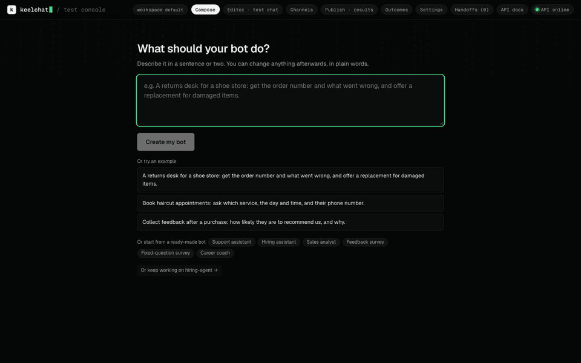
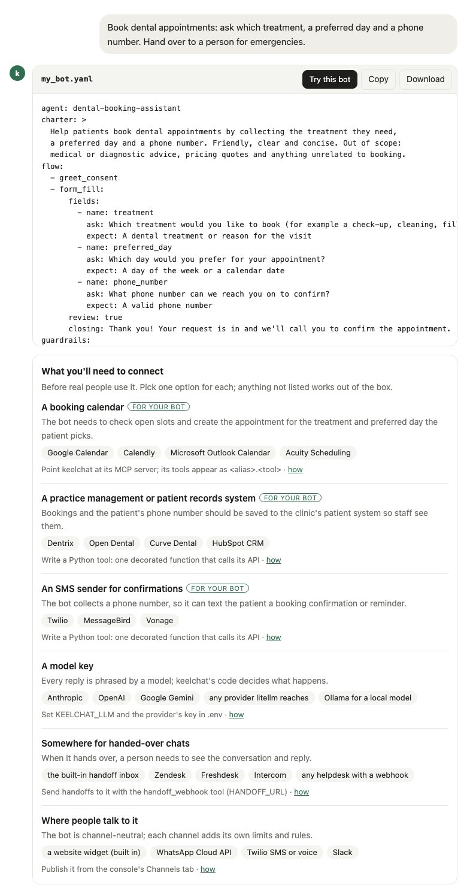
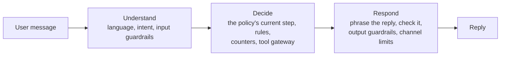

<div align="center">

# yachat

**Customer-facing chatbots that follow your rules.**<br>
Describe a bot in plain English or write it in YAML; one open-source runtime enforces its steps, limits and handoff in
code, not in a prompt.

[](https://github.com/pnrajan/yachat/actions/workflows/ci.yml)
[](pyproject.toml)
[](LICENSE)
[](#status)

**[Make a bot in your browser](https://yachat-demo.fly.dev)** · [Website](https://pnrajan.github.io/yachat/) ·
[Quickstart](#quickstart) · [Docs](#docs) · [Examples](examples) · [How it compares](#how-yachat-compares)



</div>

yachat is for bots that have a job to finish: support triage, bookings, intake forms, surveys. Each bot is one short
YAML file that says what it is for, what it asks, which tools it may use and when it must hand over to a person. You
can write that file yourself, or describe the bot in a sentence and let a model write it; either way the runtime, not
the model, decides what happens next.

- **Plain English in, a reviewable file out.** Describe the bot, read back what it will do in plain words, ask for
  changes the same way. The YAML is there when you want it.
- **Code decides, the model phrases.** Steps validate answers; re-asks, digressions, budgets and exits are counted by
  the runtime. A model never decides to end a conversation.
- **Safe by default.** Every tool call goes through one gateway (allow list, timeouts, circuit breaker); input and
  output guardrails; memory only for listed items, with consent.
- **Extend in Python.** A tool, step, guardrail or channel is one decorated function or class, or an MCP server.
- **Any model, any channel.** Anthropic or anything litellm reaches (OpenAI, Gemini, Bedrock, Ollama); web widget,
  WhatsApp, SMS, Slack and phone.
- **Tested from the policy.** Test sets are generated from the YAML, and a stronger model reviews trial chats and
  proposes fixes.

## Make a bot from plain English

**In the [demo](https://yachat-demo.fly.dev)**, no install and no sign-in: describe a bot and get its YAML, checked by
the build. Press **Try this bot** to chat with it right there (its tools answer with sample data), and ask for changes
in plain words. Under the YAML, what the bot needs connecting before real people use it, with options for each: the
services its YAML uses, and the outside systems your description implies (a booking calendar, a CRM, an SMS gateway).
Then fork the repo and run it.

A link can start a draft, which is handy in an issue or a post:
[`yachat-demo.fly.dev/?describe=Book haircuts and ask for a phone number`](https://yachat-demo.fly.dev/?describe=Book+haircuts+and+ask+for+a+phone+number).

**In the console** (after the [Quickstart](#quickstart)), open **Compose**, describe the bot, and press **Create my
bot**. It reads the bot back in plain words; ask for changes the same way ("also ask for their email", "add Spanish"),
press **Try it** to chat, and **Save** when it's right.

**From Claude Code**, the [yachat plugin](plugins/yachat) builds, tries and saves bots on your server when you ask in
plain words. See [Use with Claude](docs/FEATURES.md#use-with-claude).

<p align="center"></p>

## Quickstart

Needs macOS, Linux or WSL 2, and one model key. `setup.sh` checks for git, uv and Node 20+, offers to install
what's missing (Homebrew, apt, dnf or pacman), and asks for your key.

```bash
git clone https://github.com/pnrajan/yachat && cd yachat
./setup.sh                  # --docker to also set up Docker; --check to only report
scripts/try.sh              # the console with a sample bot, everything in memory
```

Or run the whole stack in Docker (API, console, Redis and Postgres, with data that survives restarts):
`scripts/local.sh up`.

Open **Compose** and describe a bot, or pick **Support assistant**, press **Build & try**, then **New session**, and
chat. The **Inspector** shows why each reply was chosen.

## Your first bot

Save this as `my_bot.yaml`:

```yaml
agent: support-assistant
charter: >
  Help customers with orders and returns. Friendly, concise.
  Out of scope: legal or medical advice.
languages: [en, es]
tools: [knowledge_search]
flow:
  - greet_consent
  - form_fill:
      fields:
        - {name: order_number, ask: "What is your order number?", expect: "An order number in any format, such as ORD-12345 or #98765"}
        - {name: issue, ask: "What went wrong?", expect: "A short description", optional: true}
guardrails: {input: [prompt_injection], output: [pii, no_legal_advice]}
limits: {reasks: 3, digressions: 3}
handoff: {when: [user_request, max_reasks]}
```

It asks for consent, collects an order number, answers side questions from your documents, blocks prompt
injection, removes personal details from replies, and hands over to a person when asked or stuck.

```bash
uv run yachat build my_bot.yaml   # validate and compile; errors name the YAML path
```

To chat with it, paste it into the console's editor and press **Build & try**, or send it to the API with
`POST /v1/agents` ([walkthrough](docs/DEVELOPER_GUIDE.md#one-conversation-end-to-end)).
[The policy language](docs/POLICY_LANGUAGE.md) lists every key; [examples](examples) has bots for bookings, surveys,
hiring and data questions.

## How it works

Every message goes through three stages. The model reads and phrases; the decisions in between are code.



Each conversation is pinned to the compiled policy it started on, so a change never alters a chat in progress.
[Architecture](docs/ARCHITECTURE.md) has the detail.

## Add a tool

```python
from yachat import tool


@tool("slot_search", timeout_s=3.0, retries=1)
async def slot_search(service: str, day: str = "") -> dict[str, list[str]]:
    """Open appointment slots for a service, optionally on one day."""
    return {"slots": await my_booking_api.free_slots(service, day)}
```

Type hints become the schema; the docstring is what the model reads. Allow it with `tools: [slot_search]`.
`uv run yachat new package my_caps` writes a starter package with a tool, a step, a guardrail and a passing test.

## Test it

```bash
uv run yachat evals generate my_bot.yaml           # a test set from the policy, in evals/<agent>/
uv run yachat evals check evals/support_assistant  # the checks every conversation must pass
```

In the console, **Test → Judge** has a stronger model review a chat and propose fixes to the policy or the code.

## Where a stronger model helps

yachat runs well on a small, cheap model for everyday turns. A stronger model pays off in a few places, and each is
one setting:

| Job | Why a stronger model helps | Setting |
|---|---|---|
| Writing a bot from English | Cleaner YAML on the first try, fewer build repairs, sharper suggestions for what to connect | `YACHAT_MODEL_GENERATE` |
| Reviewing trial chats | Spots what went wrong on which turn and proposes policy and code fixes | `YACHAT_MODEL_CRITIC` |
| Hard or risky steps | A step or rule marked `high_stakes: true` is written with the large model and always checked | the policy |
| Checking plans before replying | Steps with `think: true` plan first; a separate model can check the plan | `YACHAT_MODEL_VERIFY` |
| Judging test results | Scores scope and rule-following in evals | `EVALS_JUDGE_MODEL` |

Classification and routine replies stay on `YACHAT_MODEL_CLASSIFY`. [Model routing and cost](docs/REFERENCE.md) has
the detail.

## How yachat compares

| | **yachat** | **Parlant** | **Rasa** | **LangGraph** | **Botpress** |
|---|---|---|---|---|---|
| You write | One YAML file per bot, or plain English | Python guidelines and journeys | YAML flows and Python actions | Python graph code | Visual flows |
| Who decides the next step | Code, from the policy | The model, steered by matched guidelines | Code flows | Your code | Flows plus model nodes |
| Limits, guardrails, handoff | Built in, counted in code | Built in | Built in | You build them | Platform features |
| Open source | Apache-2.0 | Apache-2.0 | Pro is commercial; open source is in maintenance | MIT | Hosted; SDK is MIT |
| Maturity | Alpha | Active | Mature | Mature | Mature |

**A good fit** when a bot has a job to finish (a form, a booking, triage, a survey), its behaviour should live in a
file people can review, and you want many bots on one self-hosted runtime. **Not a fit** for a free-form assistant,
multi-agent research workflows, or if you need stable APIs today. [How yachat compares](docs/COMPARISON.md) has the
detail and sources.

## Docs

| To… | Read |
|---|---|
| write and tune a bot | [Writing an agent](docs/WRITING_AN_AGENT.md) |
| look up a policy key | [The policy language](docs/POLICY_LANGUAGE.md) |
| use the console, channels, memory, handoff, documents, Claude | [Features](docs/FEATURES.md) |
| add a tool, step, guardrail or channel | [Adding a capability](docs/ADDING_A_CAPABILITY.md) |
| test and measure quality | [Evals](docs/EVALS.md) |
| look up the CLI, API, settings, deployment | [Reference](docs/REFERENCE.md) |
| understand the runtime | [Architecture](docs/ARCHITECTURE.md) |

## Help and contributing

Questions and bots to show go to [Discussions](https://github.com/pnrajan/yachat/discussions), bugs to
[issues](https://github.com/pnrajan/yachat/issues/new/choose), vulnerabilities to [SECURITY.md](SECURITY.md).
Contributions are welcome: start with a
[good first issue](https://github.com/pnrajan/yachat/issues?q=is%3Aissue+is%3Aopen+label%3A%22good+first+issue%22), and
see [CONTRIBUTING.md](CONTRIBUTING.md) and the [code of conduct](CODE_OF_CONDUCT.md).
If yachat is useful to you, a star helps others find it.

## Status

Alpha (0.x): the policy language and APIs may still change between minor versions; [CHANGELOG.md](CHANGELOG.md)
lists every change.

## License

[Apache-2.0](LICENSE)
