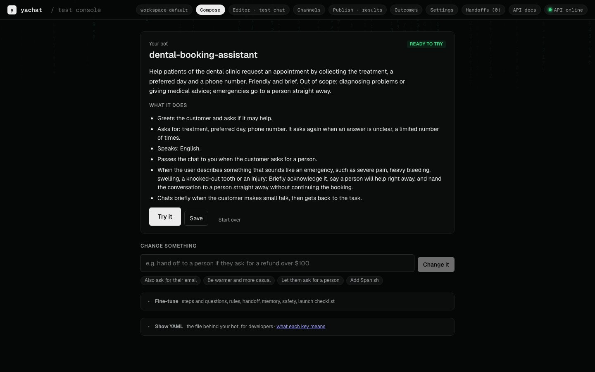
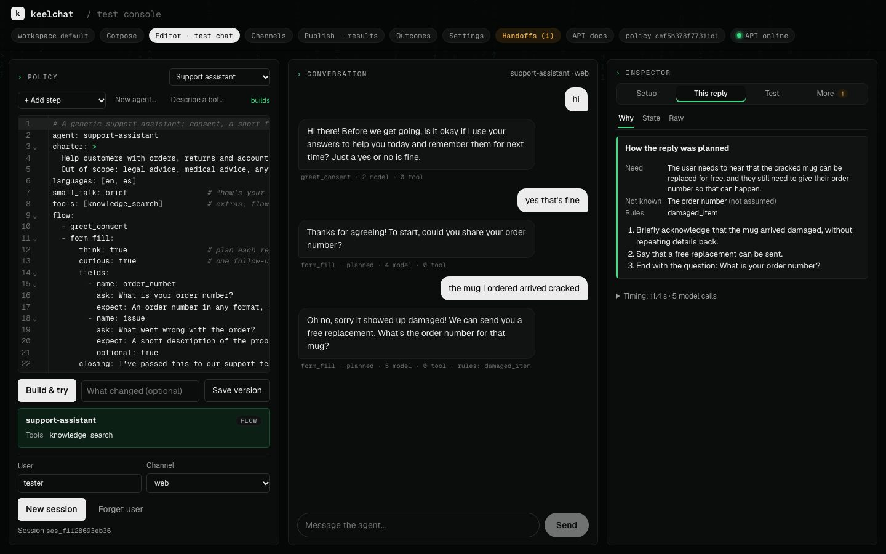
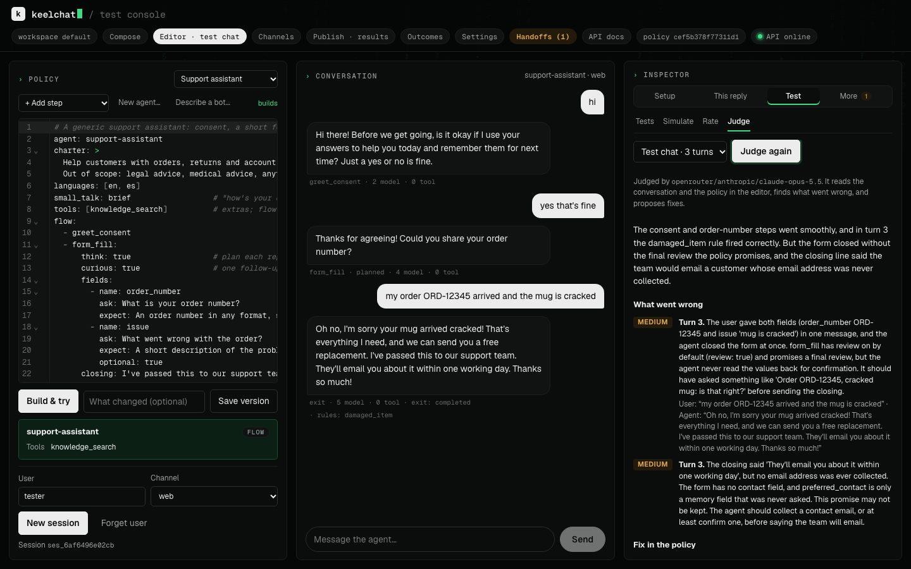
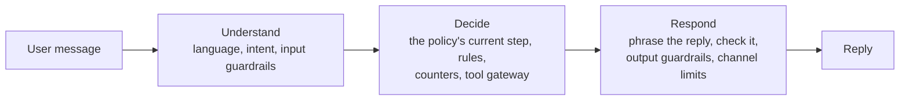
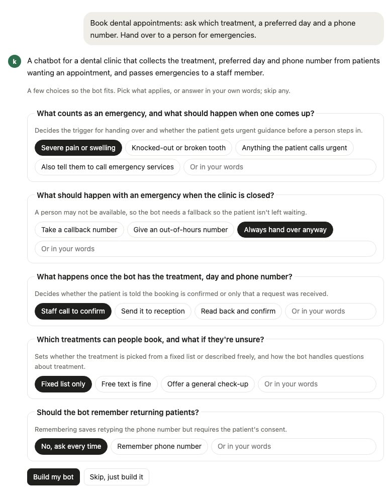
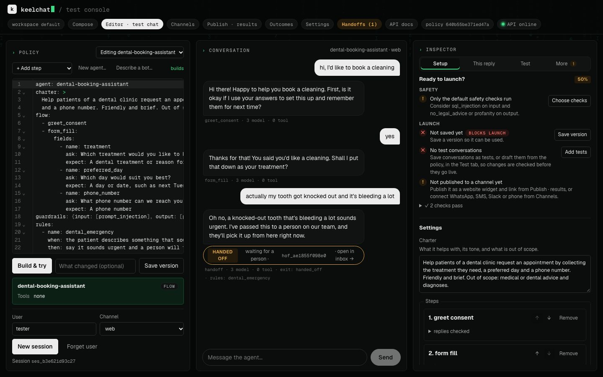

# keelchat ── Customer-facing chatbots that follow your rules

<p align="center">
  <a href="https://github.com/pnrajan/keelchat/actions/workflows/ci.yml"></a>
  <a href="https://pypi.org/project/keelchat/"></a>
  <a href="LICENSE"></a>
  <a href="#status"></a>
  <br />
  <br />
  <a href="https://keelchat-demo.fly.dev">
    
  </a>
  <br />
  <a href="#get-started">Get started</a> · <a href="#deploy-to-render">Deploy to Render</a> · <a href="#docs">Docs</a> · <a href="https://pnrajan.github.io/keelchat/">Website</a>
</p>

keelchat is an open-source framework for chatbots that talk to your customers: bookings, support requests, intake
forms, surveys. A bot is **one YAML policy**. One shared runtime runs every bot and enforces its steps, limits and
handover to a person **in code**. The model reads and phrases; code decides.

## Overview

A bot with a job to finish can't just "try its best". Prompt-only bots drift: they skip questions, loop, or promise a
person and never hand over. keelchat keeps the model for understanding and wording, and puts every decision where you
can read and test it.

You don't need to know YAML. Describe the bot in plain English, in the console's **Compose** view or the
[browser demo](https://keelchat-demo.fly.dev), and keelchat writes the YAML, reads it back to you in plain words, and
lets you try it.

<p align="center">
  
</p>

Here is the difference it makes. A patient mid-booking writes *"I just knocked a tooth out playing football"*. Replies
from the dental example bot, before and after [#31](https://github.com/pnrajan/keelchat/pull/31):

| Where the rule lives | What happens |
|---|---|
| **In the prompt** | "No problem. Which dental treatment are you looking for? I need to connect you with a staff member right away." Nobody gets the chat. |
| **In code** (`handoff: true`) | "That sounds urgent, and I'm sorry you've been through that. I've passed this to a person on our team." A person gets the chat. |

## Features

<table>
<tr>
<td colspan="2" valign="middle">

### Describe it in plain English

Say what the bot should do in a sentence or two. keelchat drafts the policy, tells you back what it will ask and
when it hands over, and takes changes in plain words ("also ask for a phone number"). The result is one short YAML
file you can review and keep in git.



</td>
</tr>
<tr>
<td width="50%" valign="top">

### Code decides, the model phrases

Answers are checked, re-asks and budgets are counted, and handover happens in code. A model never ends a
conversation or skips a step.

</td>
<td width="50%" valign="top">

### Safe by default

Tools go through one gateway (allow list, timeouts, circuit breaker). Input and output guardrails are on from the
start. Memory keeps only the items you list, with consent for sensitive ones.

</td>
</tr>
<tr>
<td colspan="2" valign="middle">

### Try it and see why

Chat with the bot next to its YAML. The **Inspector** shows why each reply was chosen: the step, the rule that
fired, and how the reply was planned.



</td>
</tr>
<tr>
<td colspan="2" valign="middle">

### A stronger model reviews your test chats

**Test → Judge** has a stronger model read a trial chat, list what went wrong on which turn, and propose fixes to
the policy or the code. Test sets are generated from the YAML.



</td>
</tr>
<tr>
<td width="50%" valign="top">

### Any model, any channel

Anthropic, or anything litellm reaches (OpenAI, Gemini, Bedrock, OpenRouter, Ollama). Web widget, WhatsApp, SMS,
Slack, phone.

</td>
<td width="50%" valign="top">

### Yours to run and extend

Apache-2.0, one Docker image, on PyPI. A tool, step, guardrail or channel is one decorated Python function or class,
or an MCP server; so is each part of knowledge search.

</td>
</tr>
</table>

**A good fit** for support triage, bookings, intake forms and surveys, with many bots on one self-hosted runtime.
**Not a fit** for a free-form assistant, multi-agent research, or anything that needs stable APIs today
([comparison](#how-keelchat-compares)). [Features](docs/FEATURES.md) has the full list.

## How it works

Every message goes through three stages. The model reads and phrases; the decisions in between are code.



- **One policy per bot.** The YAML is compiled and checked before it runs; errors name the YAML path.
- **One runtime for all bots.** Behaviour comes only from the compiled policy, never from code written for one bot.
- **Pinned conversations.** Each chat stays on the policy version it started on, so a change never alters a chat in
  progress.

[Architecture](docs/ARCHITECTURE.md) has the detail.

## Get started

| Path | Time | You need |
|---|---|---|
| [Try it in your browser](#try-it-in-your-browser) | 1 minute | Nothing |
| [Run it locally](#run-it-locally) | 5 minutes | macOS, Linux or WSL 2, and a model key |
| [Deploy to Render](#deploy-to-render) | 10 minutes | GitHub and Render accounts, and a model key |

The package is also on PyPI: `pip install "keelchat[api]"` (Python 3.12+); add `qdrant` or `chroma` for those vector
stores.

### Try it in your browser

In the [demo](https://keelchat-demo.fly.dev), with no sign-in, describe a bot, click through a few questions about
what your description leaves open (emergencies, what to collect, languages), and get its YAML. Press **Try this bot**
to chat with it (its tools answer with sample data), and see what it needs connecting before real people use it. A
link can start a draft:
[`?describe=Book haircuts and ask for a phone number`](https://keelchat-demo.fly.dev/?describe=Book+haircuts+and+ask+for+a+phone+number).

<p align="center"></p>

<p align="center"></p>

### Run it locally

```bash
git clone https://github.com/pnrajan/keelchat && cd keelchat
./setup.sh        # checks for git, uv, Node 20+; offers to install what's missing; asks for your model key
scripts/try.sh    # opens the console with a sample bot, everything in memory
```

In the console, open **Compose**, describe a bot, press **Create my bot**, then **Try it**.

<p align="center"></p>

- **Whole stack in Docker** (API, console, Redis, Postgres; data kept between restarts): `scripts/local.sh up`
- **From Claude Code:** see [Build bots from Claude Code](#build-bots-from-claude-code).

### Deploy to Render

Run keelchat in your own Render account, on the free plan.

1. **Fork** this repository, so the deploy follows your copy.
2. Open `https://render.com/deploy?repo=https://github.com/<you>/keelchat`. The button below deploys this repository
   as is, without your changes.

   [](https://render.com/deploy?repo=https://github.com/pnrajan/keelchat)

3. Sign in to Render, review the service it will create, enter your `ANTHROPIC_API_KEY` when asked, and approve.
   The first build takes a few minutes.
4. On the service's **Environment** page, copy `KEELCHAT_API_KEY`. Render generated it; it locks the console and API.
5. Open `https://<service>.onrender.com`. The console asks for the key once.

> [!IMPORTANT]
> Saved bots need a database. Without `DATABASE_URL` (and `REDIS_URL`), everything is in memory and is lost when the
> service restarts or sleeps. Add a Postgres URL on the **Environment** page.

<details>
<summary><b>Good to know:</b> other model providers, updates, sleeping</summary>

- **Another model provider:** on the **Environment** page, set `KEELCHAT_LLM=litellm`, `KEELCHAT_MODEL_GENERATE`,
  `KEELCHAT_MODEL_CLASSIFY` and the provider's key (e.g. `OPENROUTER_API_KEY`), as in [`.env.example`](.env.example).
- **Updates are not automatic.** Auto-deploy is off in [`render.yaml`](render.yaml). To redeploy each time CI passes
  on your fork, set **Auto-Deploy** to "After CI checks pass" in the service's **Settings**, or press
  **Manual Deploy**.
- **The free plan sleeps** when idle, so the first request after that is slow. A paid plan stays awake.
- For **Fly.io** and other hosts, see [Deploy from GitHub](docs/REFERENCE.md#deploy-from-github).

</details>

## Your first bot

The smallest bot is two lines. Everything else has a default.

```
agent: shop-helper
charter: Help customers with orders and returns.
```

Save it as `my_bot.yaml` and build it:

```bash
uv run keelchat build my_bot.yaml   # validate and compile; errors name the YAML path
```

It chats within its charter, with the default limits and guardrails (prompt injection blocked, personal details
removed from replies).

### When you want more

Add steps, guardrails, limits and handover as you need them. This bot asks for consent, collects an order number,
answers side questions from your documents, and hands over to a person when asked or stuck:

```yaml
agent: support-assistant
charter: >
  Help customers with orders and returns. Friendly, concise.
  Out of scope: legal or medical advice.
languages: [en, es]
tools: [knowledge_search]
flow:
  - greet_consent
  - form_fill:
      fields:
        - {name: order_number, ask: "What is your order number?", expect: "An order number in any format, such as ORD-12345 or #98765"}
        - {name: issue, ask: "What went wrong?", expect: "A short description", optional: true}
guardrails: {input: [prompt_injection], output: [pii, no_legal_advice]}
limits: {reasks: 3, digressions: 3}
handoff: {when: [user_request, max_reasks]}
```

Paste either one into the console's editor and press **Build & try**, or send it to the API with `POST /v1/agents`
([walkthrough](docs/DEVELOPER_GUIDE.md#one-conversation-end-to-end)). You never have to write this by hand: Compose
and the demo write it from plain English. [The policy language](docs/POLICY_LANGUAGE.md) lists every key;
[examples](examples) has bots for bookings, surveys, hiring and data questions.

## Answer from your documents

Give a bot a **knowledge base** (your help pages, manuals, FAQs) and it answers only from them. When they don't cover a
question, it says so instead of guessing. Several bots can share one.

- **In the console:** Compose → **Knowledge base**. Upload files (PDF, text, Markdown, CSV, HTML) and add web pages,
  press **Create knowledge base**, and apply the change it proposes. Publish → *Create a chatbot from your content*
  makes a new bot from documents in one go.
- **Indexing is picked for you** from the documents, and you're told why: small sets are read whole (full context),
  long manuals get layered summaries (RAPTOR), many pages get passages with context (contextual retrieval). You can
  choose the method and how many passages each answer gets.
- **Nothing extra to run:** the server indexes and searches knowledge bases itself, so a Render or Fly.io deploy
  answers from documents. For large sets, run the separate Knowledge Service.
- **Passages and embeddings:** documents are split with [chonkie](https://github.com/chonkie-inc/chonkie)'s semantic
  chunker and embedded with any provider's model through litellm (OpenAI, Voyage, Cohere, Gemini, Bedrock, Ollama),
  or a small local model with no key.
- **Your vector store:** in memory, LanceDB, Qdrant, Chroma or Postgres with pgvector, set with
  `KNOWLEDGE_VECTOR_STORE`.
- **From the API or YAML:** `POST /v1/tenants/{t}/documents`, or register documents already in a folder or S3 with
  `PUT /v1/tenants/{t}/datasets/{name}`, then:

  ```yaml
  flow:
    - knowledge: {dataset: help_centre}
  ```

Every part (embedding model, chunker, indexing method, vector store) can be replaced with your own: subclass the
interface, register it, and pick it with a setting. `keelchat.testing.check_vector_store` checks a store of your own
against the rules search relies on.

```python
from keelchat import VectorIndex, VectorStoreConfig, vector_store


@vector_store("mystore")  # KNOWLEDGE_VECTOR_STORE=mystore
class MyStore(VectorIndex):
    def __init__(self, cfg: VectorStoreConfig): ...

    # upsert, search, delete_doc, count
```

[Answer from documents](docs/FEATURES.md#answer-from-documents) and
[Knowledge search parts](docs/ADDING_A_CAPABILITY.md#knowledge-search-parts) have the detail.

## Add a tool

```python
from keelchat import tool


@tool("slot_search", timeout_s=3.0, retries=1)
async def slot_search(service: str, day: str = "") -> dict[str, list[str]]:
    """Open appointment slots for a service, optionally on one day."""
    return {"slots": await my_booking_api.free_slots(service, day)}
```

Type hints become the schema; the docstring is what the model reads. Allow it with `tools: [slot_search]`.
`uv run keelchat new package my_caps` writes a starter package with a tool, a step, a guardrail and a passing test.
[Adding a capability](docs/ADDING_A_CAPABILITY.md) has the detail.

## Test it

```bash
uv run keelchat evals generate my_bot.yaml           # a test set from the policy, in evals/<agent>/
uv run keelchat evals check evals/support_assistant  # the checks every conversation must pass
```

In the console, **Test → Judge** has a stronger model review a chat and propose fixes. [Evals](docs/EVALS.md) has the
detail.

## Where a stronger model helps

keelchat runs well on a small, cheap model for everyday turns. A stronger model pays off in a few places, each one
setting:

| Job | Why a stronger model helps | Setting |
|---|---|---|
| Writing a bot from English | Cleaner YAML on the first try, fewer build repairs | `KEELCHAT_MODEL_GENERATE` |
| Reviewing trial chats | Spots what went wrong on which turn and proposes fixes | `KEELCHAT_MODEL_CRITIC` |
| Hard or risky steps | `high_stakes: true` steps use the large model and are always checked | the policy |
| Checking plans before replying | `think: true` steps plan first; a separate model can check the plan | `KEELCHAT_MODEL_VERIFY` |
| Judging test results | Scores scope and rule-following in evals | `EVALS_JUDGE_MODEL` |

Classification and routine replies stay on `KEELCHAT_MODEL_CLASSIFY`. [Model routing](docs/REFERENCE.md#model-routing)
has the detail.

## Build bots from Claude Code

The [keelchat plugin](plugins/keelchat) connects Claude Code to your keelchat server. Ask for a bot in plain words;
Claude drafts the policy, tries a few conversations and shows you the result before it saves anything.

```text
/plugin marketplace add pnrajan/keelchat
/plugin install keelchat@keelchat
```

[Use with Claude](docs/FEATURES.md#use-with-claude) has the setup.

## How keelchat compares

| | **keelchat** | **Parlant** | **Rasa** | **LangGraph** | **Botpress** |
|---|---|---|---|---|---|
| You write | One YAML file per bot, or plain English | Python guidelines and journeys | YAML flows and Python actions | Python graph code | Visual flows |
| Who decides the next step | Code, from the policy | The model, steered by matched guidelines | Code flows | Your code | Flows plus model nodes |
| Limits, guardrails, handoff | Built in, counted in code | Built in | Built in | You build them | Platform features |
| Open source | Apache-2.0 | Apache-2.0 | Pro is commercial; open source is in maintenance | MIT | Hosted; SDK is MIT |
| Maturity | Alpha | Active | Mature | Mature | Mature |

[How keelchat compares](docs/COMPARISON.md) has the detail and sources.

## Docs

| To… | Read |
|---|---|
| start from zero, with diagrams and recipes | [Building agents with keelchat: a plain guide (PDF)](docs/guide/building-agents.pdf) |
| write and tune a bot | [Writing an agent](docs/WRITING_AN_AGENT.md) |
| look up a policy key | [The policy language](docs/POLICY_LANGUAGE.md) |
| use the console, channels, memory, handoff, documents, Claude Code | [Features](docs/FEATURES.md) |
| add a tool, step, guardrail, channel, or knowledge search part | [Adding a capability](docs/ADDING_A_CAPABILITY.md) |
| test and measure quality | [Evals](docs/EVALS.md) |
| look up the CLI, API, settings, deployment | [Reference](docs/REFERENCE.md) |
| understand the runtime | [Architecture](docs/ARCHITECTURE.md) |

## Contributing

- **Questions, and bots to show:** [Discussions](https://github.com/pnrajan/keelchat/discussions)
- **Bugs:** [issues](https://github.com/pnrajan/keelchat/issues/new/choose); vulnerabilities: [SECURITY.md](SECURITY.md)
- **Code:** start with a
  [good first issue](https://github.com/pnrajan/keelchat/issues?q=is%3Aissue+is%3Aopen+label%3A%22good+first+issue%22),
  and see [CONTRIBUTING.md](CONTRIBUTING.md) and the [code of conduct](CODE_OF_CONDUCT.md).

## Status

Alpha (0.x): the policy language and APIs may still change between minor versions; [CHANGELOG.md](CHANGELOG.md)
lists every change.

## License

keelchat is licensed under [Apache-2.0](LICENSE).

<p align="center"><b>If keelchat is useful to you, a ⭐ helps others find it.</b></p>
