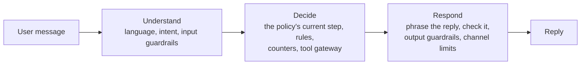

<div align="center">

# keelchat

### Customer-facing chatbots that follow your rules.

Describe a bot in plain English or write it in YAML.<br>
The runtime, not the model, enforces its steps, limits and handover to a person.

[](https://github.com/pnrajan/keelchat/actions/workflows/ci.yml)
[](pyproject.toml)
[](LICENSE)
[](#status)

**[Try it in your browser →](https://keelchat-demo.fly.dev)**

[Run it locally](#run-it-locally) · [Deploy to Render](#deploy-to-render) · [Docs](#docs) ·
[Website](https://pnrajan.github.io/keelchat/)

<br>


</div>

## Why keelchat

A bot that books appointments or takes support requests has a job to finish. Prompt-only bots drift: they skip
questions, loop, or promise a person and never hand over. keelchat keeps the model for reading and phrasing, and puts
every decision in code you can review.

A patient mid-booking writes *"I just knocked a tooth out playing football"*. Replies from the dental example bot,
before and after [#31](https://github.com/pnrajan/keelchat/pull/31); the model picks the words, code makes the handover:

| Where the rule lives | What happens |
|---|---|
| **Rule in the prompt** | "No problem. Which dental treatment are you looking for? I need to connect you with a staff member right away." Nobody gets the chat. |
| **Rule in code** (`handoff: true`) | "That sounds urgent, and I'm sorry you've been through that. I've passed this to a person on our team." A person gets the chat. |

<table>
<tr>
<td width="33%" valign="top">

**Plain English in, a file out**<br>
Describe the bot, read back what it will do, change it in plain words. The result is one short YAML file you can
review.

</td>
<td width="33%" valign="top">

**Code decides, the model phrases**<br>
Answers are validated, re-asks and budgets are counted, and handover happens in code. A model never ends a
conversation.

</td>
<td width="33%" valign="top">

**Safe by default**<br>
Tools go through one gateway (allow list, timeouts, circuit breaker), with input and output guardrails. Memory
keeps only listed items, with consent for sensitive ones.

</td>
</tr>
<tr>
<td valign="top">

**Any model, any channel**<br>
Anthropic, or anything litellm reaches (OpenAI, Gemini, Bedrock, OpenRouter, Ollama). Web widget, WhatsApp, SMS,
Slack, phone.

</td>
<td valign="top">

**Tested from the policy**<br>
Test sets are generated from the YAML; a stronger model reviews trial chats and proposes fixes.

</td>
<td valign="top">

**Yours to run and extend**<br>
Apache-2.0, one Docker image. A tool, step, guardrail or channel is one decorated Python function or class, or an
MCP server.

</td>
</tr>
</table>

**A good fit** for support triage, bookings, intake forms and surveys, with many bots on one self-hosted runtime.
**Not a fit** for a free-form assistant, multi-agent research, or anything that needs stable APIs today
([comparison](#how-keelchat-compares)).

## Get started

<table>
<tr>
<th width="33%">Try it in your browser</th>
<th width="33%">Run it locally</th>
<th width="33%">Deploy to Render</th>
</tr>
<tr>
<td valign="top">1 minute, nothing to install.<br><a href="https://keelchat-demo.fly.dev"><b>Open the demo →</b></a></td>
<td valign="top">5 minutes. macOS, Linux or WSL 2, and a model key.<br><a href="#run-it-locally"><b>Steps ↓</b></a></td>
<td valign="top">10 minutes. GitHub and Render accounts, and a model key.<br><a href="#deploy-to-render"><b>Steps ↓</b></a></td>
</tr>
</table>

### Try it in your browser

In the [demo](https://keelchat-demo.fly.dev), with no sign-in, describe a bot and get its YAML. Press **Try this bot**
to chat with it (its tools answer with sample data), and see what it needs connecting before real people use it. A
link can start a draft:
[`?describe=Book haircuts and ask for a phone number`](https://keelchat-demo.fly.dev/?describe=Book+haircuts+and+ask+for+a+phone+number).

<p align="center"></p>

### Run it locally

```bash
git clone https://github.com/pnrajan/keelchat && cd keelchat
./setup.sh        # checks for git, uv, Node 20+; offers to install what's missing; asks for your model key
scripts/try.sh    # opens the console with a sample bot, everything in memory
```

In the console, open **Compose**, describe a bot, press **Create my bot**, then **Try it**. The **Inspector** shows
why each reply was chosen.

- **Whole stack in Docker** (API, console, Redis, Postgres; data kept between restarts): `scripts/local.sh up`
- **From Claude Code:** the [keelchat plugin](plugins/keelchat) builds and tries bots when you ask in plain words.

### Deploy to Render

Run keelchat in your own Render account, on the free plan.

1. **Fork** this repository, so the deploy follows your copy.
2. Open `https://render.com/deploy?repo=https://github.com/<you>/keelchat`. The button below deploys this repository
   as is, without your changes.

   [](https://render.com/deploy?repo=https://github.com/pnrajan/keelchat)

3. Sign in to Render, review the service it will create, enter your `ANTHROPIC_API_KEY` when asked, and approve.
   The first build takes a few minutes.
4. On the service's **Environment** page, copy `KEELCHAT_API_KEY`. Render generated it; it locks the console and API.
5. Open `https://<service>.onrender.com`. The console asks for the key once.

> [!IMPORTANT]
> Saved bots need a database. Without `DATABASE_URL` (and `REDIS_URL`), everything is in memory and is lost when the
> service restarts or sleeps. Add a Postgres URL on the **Environment** page.

<details>
<summary><b>Good to know:</b> other model providers, updates, sleeping</summary>

- **Another model provider:** on the **Environment** page, set `KEELCHAT_LLM=litellm`, `KEELCHAT_MODEL_GENERATE`,
  `KEELCHAT_MODEL_CLASSIFY` and the provider's key (e.g. `OPENROUTER_API_KEY`), as in [`.env.example`](.env.example).
- **Updates are not automatic.** To redeploy each time CI passes on your fork, set **Auto-Deploy** to "After CI
  checks pass" in the service's **Settings**, or press **Manual Deploy**.
- **The free plan sleeps** when idle, so the first request after that is slow. A paid plan stays awake.
- Settings are in [`render.yaml`](render.yaml). For **Fly.io** and other hosts, see
  [Deploy from GitHub](docs/REFERENCE.md#deploy-from-github).

</details>

## Your first bot

Save this as `my_bot.yaml`:

```yaml
agent: support-assistant
charter: >
  Help customers with orders and returns. Friendly, concise.
  Out of scope: legal or medical advice.
languages: [en, es]
tools: [knowledge_search]
flow:
  - greet_consent
  - form_fill:
      fields:
        - {name: order_number, ask: "What is your order number?", expect: "An order number in any format, such as ORD-12345 or #98765"}
        - {name: issue, ask: "What went wrong?", expect: "A short description", optional: true}
guardrails: {input: [prompt_injection], output: [pii, no_legal_advice]}
limits: {reasks: 3, digressions: 3}
handoff: {when: [user_request, max_reasks]}
```

It asks for consent, collects an order number, answers side questions from your documents, blocks prompt
injection, removes personal details from replies, and hands over to a person when asked or stuck.

```bash
uv run keelchat build my_bot.yaml   # validate and compile; errors name the YAML path
```

Paste it into the console's editor and press **Build & try**, or send it to the API with `POST /v1/agents`
([walkthrough](docs/DEVELOPER_GUIDE.md#one-conversation-end-to-end)). [The policy language](docs/POLICY_LANGUAGE.md)
lists every key; [examples](examples) has bots for bookings, surveys, hiring and data questions.

## How it works

Every message goes through three stages. The model reads and phrases; the decisions in between are code.



Each conversation is pinned to the compiled policy it started on, so a change never alters a chat in progress.
[Architecture](docs/ARCHITECTURE.md) has the detail.

## Add a tool

```python
from keelchat import tool


@tool("slot_search", timeout_s=3.0, retries=1)
async def slot_search(service: str, day: str = "") -> dict[str, list[str]]:
    """Open appointment slots for a service, optionally on one day."""
    return {"slots": await my_booking_api.free_slots(service, day)}
```

Type hints become the schema; the docstring is what the model reads. Allow it with `tools: [slot_search]`.
`uv run keelchat new package my_caps` writes a starter package with a tool, a step, a guardrail and a passing test.

## Test it

```bash
uv run keelchat evals generate my_bot.yaml           # a test set from the policy, in evals/<agent>/
uv run keelchat evals check evals/support_assistant  # the checks every conversation must pass
```

In the console, **Test → Judge** has a stronger model review a chat and propose fixes to the policy or the code.

## Where a stronger model helps

keelchat runs well on a small, cheap model for everyday turns. A stronger model pays off in a few places, each one
setting:

| Job | Why a stronger model helps | Setting |
|---|---|---|
| Writing a bot from English | Cleaner YAML on the first try, fewer build repairs | `KEELCHAT_MODEL_GENERATE` |
| Reviewing trial chats | Spots what went wrong on which turn and proposes fixes | `KEELCHAT_MODEL_CRITIC` |
| Hard or risky steps | `high_stakes: true` steps use the large model and are always checked | the policy |
| Checking plans before replying | `think: true` steps plan first; a separate model can check the plan | `KEELCHAT_MODEL_VERIFY` |
| Judging test results | Scores scope and rule-following in evals | `EVALS_JUDGE_MODEL` |

Classification and routine replies stay on `KEELCHAT_MODEL_CLASSIFY`. [Model routing and cost](docs/REFERENCE.md) has
the detail.

## How keelchat compares

| | **keelchat** | **Parlant** | **Rasa** | **LangGraph** | **Botpress** |
|---|---|---|---|---|---|
| You write | One YAML file per bot, or plain English | Python guidelines and journeys | YAML flows and Python actions | Python graph code | Visual flows |
| Who decides the next step | Code, from the policy | The model, steered by matched guidelines | Code flows | Your code | Flows plus model nodes |
| Limits, guardrails, handoff | Built in, counted in code | Built in | Built in | You build them | Platform features |
| Open source | Apache-2.0 | Apache-2.0 | Pro is commercial; open source is in maintenance | MIT | Hosted; SDK is MIT |
| Maturity | Alpha | Active | Mature | Mature | Mature |

[How keelchat compares](docs/COMPARISON.md) has the detail and sources.

## Docs

| To… | Read |
|---|---|
| write and tune a bot | [Writing an agent](docs/WRITING_AN_AGENT.md) |
| look up a policy key | [The policy language](docs/POLICY_LANGUAGE.md) |
| use the console, channels, memory, handoff, documents, Claude Code | [Features](docs/FEATURES.md) |
| add a tool, step, guardrail or channel | [Adding a capability](docs/ADDING_A_CAPABILITY.md) |
| test and measure quality | [Evals](docs/EVALS.md) |
| look up the CLI, API, settings, deployment | [Reference](docs/REFERENCE.md) |
| understand the runtime | [Architecture](docs/ARCHITECTURE.md) |

## Help and contributing

- **Questions, and bots to show:** [Discussions](https://github.com/pnrajan/keelchat/discussions)
- **Bugs:** [issues](https://github.com/pnrajan/keelchat/issues/new/choose); vulnerabilities: [SECURITY.md](SECURITY.md)
- **Contributing:** start with a
  [good first issue](https://github.com/pnrajan/keelchat/issues?q=is%3Aissue+is%3Aopen+label%3A%22good+first+issue%22),
  and see [CONTRIBUTING.md](CONTRIBUTING.md) and the [code of conduct](CODE_OF_CONDUCT.md).

## Status

Alpha (0.x): the policy language and APIs may still change between minor versions; [CHANGELOG.md](CHANGELOG.md)
lists every change.

## License

[Apache-2.0](LICENSE)

<div align="center">

<br>

**If keelchat is useful to you, a ⭐ helps others find it.**

</div>
