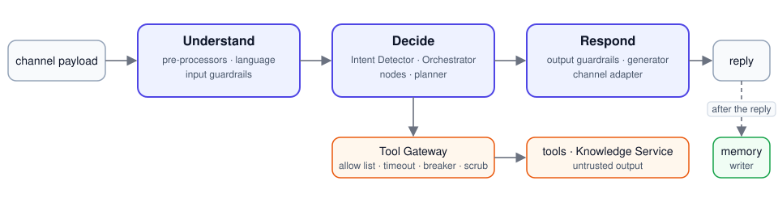

# yachat architecture

What the system is made of, how a message moves through it, and how it is deployed; it stays at the level of
components and contracts.

## 1. Components

```
                    ┌───────────────────────────── AgentBuild ─────────────────────────────┐
  agent.yaml ──────▶│ loader ─▶ Pydantic models (extra=forbid) ─▶ validator ─▶ compiler     │──▶ CompiledPolicy
                    │           (policy/models.py)      (registry checks,   (defaults,      │    (frozen, hashed)
                    │                                    DAG, memory types)  allow list)    │
                    └──────────────────────────────────────────────────────────────────────┘
                                                           │ POST /v1/agents
                                                           ▼
   channel payload   ┌──────────────────────────── AgentRuntime ───────────────────────────┐
  (web/slack/sms/ ──▶│ Runtime.turn: lock · dedupe · pin policy · run Pipeline · save state │──▶ channel messages
   whatsapp)         │                                                                      │
                     │   Understand ─────▶ Decide ─────────────▶ Respond                    │
                     │   pre-processors    Intent Detector       output guardrails          │
                     │   (receiver,        Orchestrator          Response Generator         │
                     │    opt-out,         ├─ nodes (steps)      channel adapter            │
                     │    language,        ├─ planner                                       │
                     │    shorthand,       └─ Tool Gateway ──▶ tools ──▶ HTTP backends      │
                     │    entities,                           ActionRunner ─▶ actions       │
                     │    input guardrails)                                                 │
                     │                                       Memory writer (async task)     │
                     └──────┬───────────────────────────┬───────────────────────┬──────────┘
                            ▼                           ▼                       ▼
                     SessionStore                 MemoryStore            Knowledge Service
                     (in-memory | Redis)      (in-memory | Postgres)   (own process: docs on S3,
                                                                        LanceDB index, embedder)
```

| Component | Package | Responsibility |
|---|---|---|
| Policy (AgentBuild) | `yachat/policy/` | YAML → `CompiledPolicy`: eight fields, resolved defaults, step graph, allow list, typed memory, content hash |
| Registry | `yachat/registry/` | one registry of capabilities (`@tool`, `@action`, `@node`, `@guardrail`, `@preprocessor`), auto-discovery (`capabilities/` + entry points), manifest, contract suite |
| Runtime | `yachat/runtime/` | the three stages, `TurnContext`, pipeline timing and short-circuit, LLM clients, Tool Gateway, composition (`runtime.py`) |
| Capabilities | `yachat/capabilities/` | the shipped tools, nodes, guardrails, pre-processors and the `submit_application` action |
| State | `yachat/state/` | `SessionState` (versioned), `MemoryRecord`, step graph, memory writer, Redis and Postgres adapters |
| Channels | `yachat/channels/` | payload normalisation, compliance (SMS STOP), rendering limits per channel |
| Registry extras | `yachat/registry/mcp.py`, `tenant_tools.py` | MCP servers' tools (`<alias>.<tool>`) and tenant-registered HTTP tools, both behind the Tool Gateway |
| Knowledge | `yachat/knowledge/` | document store, embedder, vector index, indexing strategies, `KnowledgeService`, and its HTTP API |
| API | `yachat/api/app.py` | FastAPI surface over the runtime; serves the built console |
| Evals | `evals/` | replay sets, personas, DeepEval metric catalogue, thresholds gate, online outcome split |
| Console | `frontend/` | React test console: policy editor, chat, trace and state inspector |

## 2. The policy is the only product surface

Behaviour comes from `CompiledPolicy`; the runtime never branches on an agent name. The YAML has eight fields:
`agent`, `charter`, `languages`, `tools`, `flow`, `guardrails`, `limits`, `memory` (plus `mode`). The compiler merges
`Defaults` (re-asks, digressions, nudges, session TTL, base guardrails, tool-failure cap, intent timeout...) into the
policy so a session pinned to a hash sees the same behaviour for its whole life. Scope and tone live only in the
charter text, which every prompt receives.

## 3. Life of a message

<p align="center"></p>

1. **Channel adapter** turns the raw payload into `InboundMessage{text, user_id, channel_message_id, action?}`. SMS
   `STOP` is answered by the channel before the pipeline runs.
2. **Runtime.turn** takes the per-session lock, drops duplicates by `channel_message_id`, loads state and the pinned
   policy, builds a `TurnContext` and runs the pipeline. Every stage is `async def run(ctx) -> ctx`; a stage can set
   the reply and short-circuit to Respond. Each sub-step is timed into the trace and `/v1/metrics`.
3. **Understand** runs the registered pre-processors in order: receiver (loads non-stale memory into the context and the
   gateway's sensitive-value scrubber), opt-out, language (detect, confirm before switching), shorthand expansion,
   entity normalisation, input guardrails (`prompt_injection` always on).
4. **Decide**
   - The **Intent Detector** (classify model, structured output, few-shots from `intent_examples.yaml`) returns a *list*
     of intents: `new_answer` with fields, `edit` with the edited field, `enquiry` (optionally `on_step` or
     `needs_multi_step`), `off_topic`, plus `clear_outputs` and `in_scope`. Counting is done in code from this verdict:
     digressions, nudges, re-asks, reopens, tool failures. A model never decides to exit.
   - The **Orchestrator** applies edits (reopening the owning step), clears outputs, routes to the next ready step of the
     `StepGraph`, runs the node, chains completed steps in the same turn, answers an enquiry alongside an answer, and
     runs the planner for `needs_multi_step` enquiries in adaptive mode. Completed sessions turn edits into follow-up
     records.
   - **Nodes** (`greet_consent`, `job_search`, `form_fill`, `knowledge`, `exit`) ask one question at a time, validate
     answers with the model, confirm prefilled or remembered values, and reach tools only through the **Tool Gateway**
     (allow list, timeouts, retries, circuit breaker, sensitive-value scrub). Actions (`submit_application`) run only
     through `ActionRunner` with the candidate's own explicit submit.
5. **Respond** runs output guardrails with step context (`pii` always on; allowed PII per field), renders in the session
   language (tool text marked `translate=False` stays as posted), and the channel adapter splits or formats for its
   limits.
6. **After the reply** the state is saved with optimistic versioning and the **memory writer** runs as a background
   task: typed JSON-schema extraction per policy field, `from` fields copy validated answers, sensitive fields need
   consent and must be volunteered, flagged turns are never used, values decay by half-life.

## 4. Models and providers

`runtime/llm.py` defines `LLMClient` (`complete`, `structured`) and `LLMRequest{purpose, model, system, messages,
metadata}`. Two clients: the Anthropic SDK (`AnthropicLLMClient`) and `LiteLLMClient` for SiliconFlow, OpenRouter and
anything else litellm routes. `runtime/llm_factory.py:llm_from_env` chooses from `YACHAT_LLM`; a selected
provider with a missing key raises. Routing is layered by environment: direct provider, a LiteLLM gateway
(`LITELLM_PROXY_URL`, owns fallbacks, retries, cost logging), or a Headroom proxy in front of it (`HEADROOM_PROXY_URL`,
context compression). Model tiers are pinned per build in `CompiledPolicy.models` and honoured per session. Three model roles: `classify` (intent, validation, planning steps, the planner's grounding check),
`generate` (replies, knowledge answers, planner drafts) and `verify` (reply and reasoning checks; the generate model
when `YACHAT_MODEL_VERIFY` is unset). There is no fake model anywhere: tests, simulations and
evals call the configured provider.

Usage and cost: each client's provider call is decorated with `runtime/usage.py:metered`. It records model, purpose,
tokens in, out and cached, time and cost to the turn's meter (a context variable), and the runtime writes them to the
audit log. Behind a LiteLLM gateway it reads the routed model and the gateway's cost from the response headers;
behind Headroom, the tokens saved. A service that makes its own model calls (the Analytics Service) collects them with
`metering()` and returns them in its response, and the runtime adds them to the turn that called it.

Dashboards add up in DuckDB, not in Python. `runtime/audit.py:audit_db` loads one tenant's window into a private
in-memory DuckDB table through the audit store port (`AuditStore.copy_to`, every field but the words people wrote):
Postgres streams it out with `COPY`, the Iceberg archive is read by DuckDB straight from its Parquet files on S3
(only that tenant's day partitions), and the in-memory store inserts its rows. With the archive on, records before its
cursor come from the archive and the rest from Postgres, so each is counted once. The cost page, the outcome dashboard,
the audit summary and the key metrics are SQL over that table; for key-metric questions the five tables are built from
it in SQL, `audit` is dropped and the database is locked before the model's query runs.

## 5. Knowledge Service

Runs as its own process (`yachat knowledge serve`) and owns its sources. The runtime's
`knowledge_search` tool is a thin HTTP client (`POST /search`). Inside: `DocumentStore` (S3 or memory),
`VectorIndex` (LanceDB or memory; with an S3 bucket the index sits beside the documents at
`s3://<bucket>/knowledge/index`, one copy every server shares, committed with S3 conditional writes), `Embedder` (SiliconFlow via litellm, or a hashed fake), a `SemanticChunker`
(whole sentences grouped by embedding distance and paragraph breaks, size-capped; never a word count) and an
`Indexer` per strategy. `contextual` and `raptor` call the generate model while indexing, so the service needs the same model
configuration as the runtime when those strategies are selected.

### Datasets and the Analytics Service

A dataset (`yachat/datasets/`) is a tenant-scoped description of sources: `structured` tables (CSV, Parquet, a
Parquet folder or S3 prefix) or `unstructured` documents. The runtime keeps the catalog (`DatasetStore`: memory or
Postgres); the service that reads a kind (Knowledge for unstructured, Analytics for structured) checks the sources at
registration and loads them on first use, keyed by the dataset's content version. Node configs name datasets with
`StructuredRef` / `UnstructuredRef`; the compiler checks them against the catalog and pins the names; the Tool Gateway
resolves a tool's `dataset` argument only to the policy's datasets for that tenant.

The Analytics Service (`yachat/analytics/`, `yachat analytics serve`) answers `POST /analyze` with an
`AnalysisResult`:

1. Resolve a follow-up into a standalone question (session history: last questions and their SQL, no rows).
2. Decide whether statistics are needed (small model), then plan before any work (`yachat/reasoning`): the
   method, why it fits, what it assumes, and 2-5 checks the result must pass. With statistics, checks that can be
   computed are Python assertions over the answer.
3. SQL with Vanna's one-shot generator on our `LLMClient`; DuckDB runs it on a locked in-memory copy (one SELECT, row
   cap, timeout); errors are fed back up to `repairs.sql` times.
4. Statistics, when needed: a smolagents `CodeAgent` (model: our `LLMClient`; executor: the `Sandbox` port) for at
   most `repairs.code + 1` steps. Sandboxes: llm-sandbox (bubblewrap, Docker, Podman) or AWS AgentCore; one fresh
   sandbox per run, no network, nothing kept. `final_answer` runs the code checks and rejects an answer that fails
   one, so the agent fixes its analysis.
5. Interpret (one structured call), then checks in code: every number grounded in the result, its subtotals and
   statistics or the code output (re-asked up to `repairs.interpret` times, then dropped); recommendations must cite
   findings; system assumptions (truncation, nulls, small samples) added by code.
6. Verify: a separate call (`YACHAT_MODEL_VERIFY`) judges the checks not run in code and lists problems, each
   tagged with the stage that must fix it. The next round redoes the analysis from the earliest such stage, up to
   `repairs.verify` times. Pass or fail is derived in code from the structured verdict; a failed one makes the result
   `partial`. Knowledge answers use the same loop, with claims checked against the passages.

## 6. Deployment topology

```
                 ┌─────────────────────────┐        ┌──────────────────────────┐
  browsers ─────▶│ API + console           │──HTTP─▶│ Knowledge Service        │
  channels ─────▶│ :8080                   │        │ :8080, one or more       │
                 └─────┬──────────┬────────┘        │ servers                  │
                       │          │                 └─────────┬────────────────┘
                   Redis       Postgres          S3: documents + LanceDB index (shared)
                 (sessions)    (memory)               SiliconFlow (embeddings)
                         model provider: Anthropic / SiliconFlow / OpenRouter
```

One Docker image serves the API and the Knowledge and Analytics Services; they differ only in the process command,
environment and volume. Any container host works. `scripts/dev.sh --knowledge` starts the same two processes locally, with in-process stores and
fake backends for tools that have no URL.

## 7. Boundaries and contracts

- Every external dependency sits behind a port with an in-memory fake: `SessionStore`, `MemoryStore`, each tool
  (`FakeTools`), each channel, `Embedder`, `DocumentStore`, `VectorIndex`. The model is the exception: it is always real.
- Validation at every boundary: YAML through Pydantic with `extra="forbid"` and path-qualified errors, capability config
  through the capability's registered schema, HTTP through Pydantic, tool payloads converted to typed models at the
  gateway, LLM JSON converted to typed verdicts in the detector.
- Typed errors: `PolicyValidationError`, `ToolError{kind}`, `LLMError`, `VersionConflict`, `PolicyRetired`, `NotFound`.
  Vendor error text is logged, never shown to the user.
- Structured JSON logs carry `session_id`, `turn_id`, `policy_hash`, `stage`, `latency_ms`; user text is logged only
  after PII redaction and sensitive memory values are never logged.

## 8. Testing and evaluation

- `tests/`: one file per area, driven through `Runtime` and the HTTP app with the real model from `.env`, fake tools
  and stores, 3 workers in parallel (provider rate limits). `tests/helpers.py:RecordingLLM` records every request so tests assert on what the
  runtime asked (purpose, metadata, allowed tools), never on canned answers. The contract suite
  (`registry/contract.py`) is what a capability from another team must pass.
- `evals/`: replay sets per agent with structural expectations, personas, DeepEval metrics with a litellm judge, a
  thresholds gate for CI, and an online outcome split for production sessions. See `EVALS.md`.

## 9. Extending

A new agent is a YAML file. A new capability is a decorated function or class under `capabilities/` or shipped as an
`yachat.capabilities` entry point (`examples/contrib_tool/`), validated by the contract suite and listed in the
manifest. A new channel implements `channels/base.py`. A new store implements the port in `state/store.py`. See
`ADDING_A_CAPABILITY.md`.
