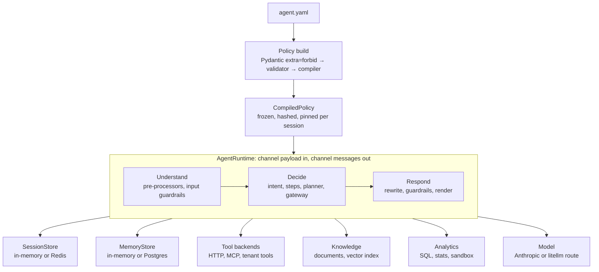
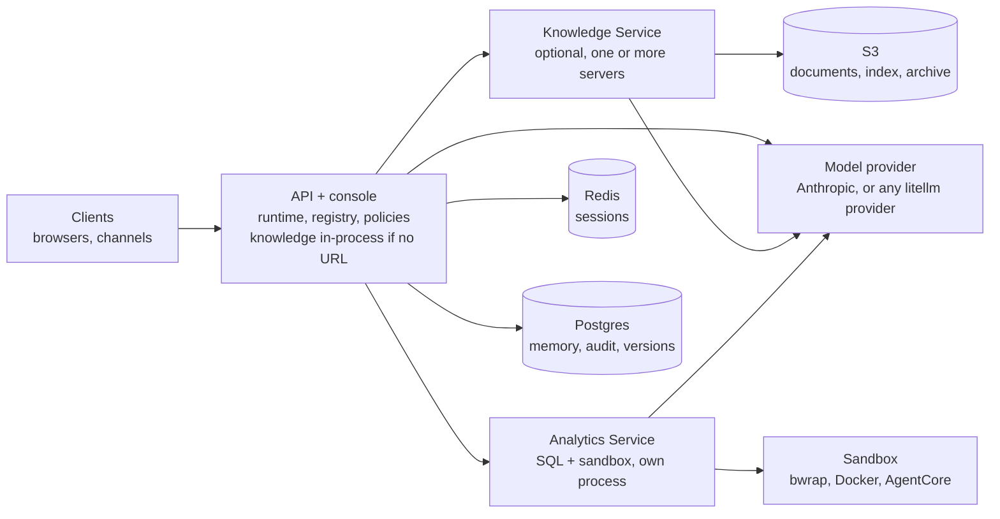

# keelchat architecture

A developer-facing guide to the whole system: the policy, the turn pipeline, capabilities, the Tool Gateway,
models, knowledge and analytics, state and channels, the API and deployment, boundaries and testing. The shorter
component reference is [`ARCHITECTURE.md`](ARCHITECTURE.md).

## 1. At a glance

keelchat runs conversational agents. Each agent is one YAML file, the **policy**, compiled once into an immutable
`CompiledPolicy` and run by one shared runtime that never branches on which agent it is running. Capabilities
(tools, steps, guardrails, pre-processors, actions) are decorated Python registered in one auto-discovered registry;
the policy names them. Everything outside the process sits behind a port with an in-memory fake. The model is the
one exception: it is always real.



| Component | Package | Responsibility |
|---|---|---|
| Policy (AgentBuild) | `keelchat/policy/` | YAML → `CompiledPolicy`: keys, resolved defaults, step graph, allow list, typed memory, content hash |
| Registry | `keelchat/registry/` | one registry of capabilities, auto-discovery (`capabilities/` + entry points), manifest, contract suite |
| Runtime | `keelchat/runtime/` | the three stages, `TurnContext`, pipeline timing and short-circuit, LLM clients, Tool Gateway, composition (`runtime.py`) |
| Capabilities | `keelchat/capabilities/` | shipped tools, nodes, guardrails, pre-processors, the `submit_application` action |
| State | `keelchat/state/` | versioned `SessionState`, `MemoryRecord`, step graph, memory writer, Redis and Postgres adapters, audit and Iceberg archive |
| Channels | `keelchat/channels/` | payload normalisation, compliance (SMS STOP), rendering limits per channel |
| Registry extras | `keelchat/registry/mcp.py`, `tenant_tools.py` | MCP servers' tools (`<alias>.<tool>`) and tenant-registered HTTP tools, both behind the gateway |
| Knowledge | `keelchat/knowledge/` | document store, embedder, chunker, vector index, indexing strategies, `KnowledgeService` and its HTTP API |
| Datasets, Analytics | `keelchat/datasets/`, `keelchat/analytics/` | tenant-scoped dataset catalog; the Analytics Service (SQL, statistics in a sandbox, verified interpretation) |
| API | `keelchat/api/app.py` | FastAPI surface over the runtime; serves the built console |
| Evals | `keelchat/evals/`, sets in `evals/<agent>/` | replay sets on the simulator's engine, DeepEval and Ragas metrics, rule checks, thresholds gate |
| Console | `frontend/` | React console: compose, policy editor, chat, trace and state inspector, dashboards |

The laws the codebase holds to:

| # | Law |
|---|---|
| 1 | Behaviour comes only from `CompiledPolicy`. Never branch on an agent name. |
| 2 | Understand → Decide → Respond; each step is `async def run(ctx: TurnContext) -> TurnContext`. |
| 3 | Every external dependency sits behind a port with an in-memory fake, wired only in `runtime/runtime.py` and the `service_from_env` functions. |
| 4 | Tools are called only through the Tool Gateway. Tool output is untrusted. |
| 5 | Code counts re-asks, nudges and budgets. A model never decides to exit. |
| 6 | Channels own their limits and compliance. Responses are channel-neutral. |
| 7 | Compiled policies are immutable and pinned per session. |
| 8 | Memory: policy-listed items only, consent for sensitive items, never to tools, never from flagged turns, deletable per user. |
| 9 | Model-written code runs only behind the `Sandbox` port. |

## 2. The policy

The policy is the only product surface. Two keys make a working agent (`agent`, `charter`); everything else has a
default. The build rejects unknown keys and names the YAML path of any error. Full reference:
[`POLICY_LANGUAGE.md`](POLICY_LANGUAGE.md).

| Key | Default | Meaning |
|---|---|---|
| `agent` | required | The agent's id. Versions, tests and ratings belong to it. |
| `charter` | required | What it helps with, its tone, what is out of scope. Scope and tone live only here; every prompt receives it. |
| `languages` | `[en]` | Languages it speaks; the first is the fallback. |
| `tools` | none | Extra tools for side questions at any point. Steps bring their own. |
| `flow` | none | Ordered steps. No flow means an open, planner-routed conversation. |
| `mode` | `flow` with a flow, else `planner` | `flow`: next step each turn. `planner`: pick read-only tools each turn. `adaptive`: a flow where a multi-lookup question may use the planner for one turn. |
| `rules` | none | `{name, when, then}` applied where `when` holds; `overrides`, `high_stakes`, `handoff: true`. |
| `guardrails` | `prompt_injection`, `sql_injection` in; `pii`, `profanity` out | Named checks; `prompt_injection` and `pii` always run. |
| `limits` | platform defaults | `reasks` 3, `digressions` 3, `reopens` 2, `planner_calls` 6, `on_step_enquiries` 3, `repairs`. Counted in code. |
| `memory` | none | Typed items remembered across conversations: `field`, `extract` or `from`, `type`, `half_life` 180d, `sensitive`, `confirm_on_reuse`. |
| `handoff` | never | `when` from `user_request`, `max_reasks`, `disengaged`, `tool_unavailable`; `notify` write tool; `timeout`. |
| `small_talk` | `off` | `off` counts chit-chat as a digression; `brief` or `warm` answers once and returns. |

**Steps.** Built in: `greet_consent`, `form_fill`, `survey`, `conversation_survey`, `knowledge`, `analytics`,
`job_search`, `exit` (and `handoff`, run from the top-level key). Any step takes `requires`, `mode`, `rules`,
`think`, `high_stakes`, `model`, `verify`, `repairs`. Registered custom nodes appear under their own name.

A complete bot is this small:

```yaml
agent: shop-helper
charter: "Help customers with orders and returns. Out of scope: legal advice."
tools: [knowledge_search]
flow:
  - greet_consent
  - form_fill:
      fields:
        - {name: order_number, ask: "What is your order number?", expect: An order number in any format}
handoff: {when: [user_request]}
```

Everything else (`rules`, `guardrails`, `limits`, `memory`, `small_talk`, step options) is added only when
needed; each has a platform default.

**Compilation** (`keelchat/policy/`), four steps:

1. **Load** into Pydantic models with `extra="forbid"`; errors are `PolicyValidationError` with the YAML path.
2. **Validate** against the registry: every step, tool and guardrail exists; step settings fit the node's
   `config_model`; `requires` forms a DAG; memory types parse; datasets exist in the tenant's catalog with the right
   kind; `mode` agrees with `flow`.
3. **Compile**: merge `Defaults` (re-asks, digressions, nudges, session TTL, base guardrails, tool-failure cap,
   planner correction budget, intent timeout); build the step graph; allow list = top-level `tools` ∪ each step's
   tools; cap `repairs` at each capability's maxima; pin model tiers.
4. **Hash.** A session pins the hash at start and keeps it for its whole life. Saved versions are addressed by
   `(tenant, agent, hash)`; `manifest_versions` records the version of each capability named, so a changed
   capability is detectable.

Entry points: `uv run keelchat build file.yaml`, `uv run keelchat schema`, `POST /v1/agents/validate`,
`POST /v1/tenants/{t}/agents` (saves a version; `.../versions/{v}/activate` switches). The console's Compose writes
a policy from a plain-English description; `POST /v1/agents/draft` and `/edit` do the same over HTTP.

## 3. Life of a message

```mermaid
flowchart LR
  subgraph U[Understand]
    direction TB
    u1[receiver · opt_out · handoff]
    u2[language · shorthand · entities]
    u3[input guardrails · confirm_stop]
  end
  subgraph D[Decide]
    direction TB
    d1[Intent Detector: structured verdict, counted in code]
    d2[Orchestrator: edits, routing, nodes, planner]
  end
  subgraph R[Respond]
    direction TB
    r1[Rewriter: goal → words, checked]
    r2[output guardrails, pii always]
    r3[Response Generator, channel stage]
  end
  U --> D --> R
  D --> G[Tool Gateway<br/>allow list, validation, scrub] --> T[Tools<br/>@tool · MCP · tenant HTTP]
  R --> MW[Memory writer<br/>after the reply, background]
```

1. **Channel adapter** turns the raw payload into `InboundMessage{text, user_id, channel_message_id, action?}`.
   SMS `STOP` is answered by the channel before the pipeline runs.
2. **Runtime.turn** takes the per-session lock, drops duplicates by `channel_message_id`, loads state and the pinned
   policy, builds a `TurnContext` and runs the pipeline. Every stage is `async def run(ctx) -> ctx`; a stage can set
   the reply and short-circuit to Respond. Each sub-step is timed into the trace and `/v1/metrics`.
3. **Understand** runs the registered pre-processors in order: receiver (loads non-stale memory into the context and
   the gateway's sensitive-value scrubber), opt_out, handoff_request, language (detect, confirm before switching),
   shorthand expansion, entity normalisation, input guardrails (`prompt_injection` always on), confirm_stop.
4. **Decide.** The **Intent Detector** (classify model, structured output, few-shots from `intent_examples.yaml`)
   returns a list of intents: `new_answer` with fields, `edit` with the edited field, `enquiry` (optionally
   `on_step` or `needs_multi_step`), `off_topic`, plus `clear_outputs` and `in_scope`. Digressions, nudges, re-asks,
   reopens and tool failures are counted in code from this verdict. The **Orchestrator** applies edits (reopening
   the owning step), clears outputs, routes to the next ready step of the `StepGraph`, runs the node, chains
   completed steps in the same turn, answers an enquiry alongside an answer, and runs the planner for
   `needs_multi_step` enquiries in adaptive mode. **Nodes** ask one question at a time, validate answers with the
   model, confirm prefilled or remembered values, and reach tools only through the Tool Gateway. Actions run only
   through `ActionRunner` with the user's own explicit action.
5. **Respond** runs four stages. The **Rewriter** words each step's goal in the charter's tone, then runs the fact
   check and the step's verifier. **Output guardrails** run with step context (`pii` always on; allowed PII per
   field), one after another on the text the previous one left, so redactions compose and a block is final; they run
   on short-circuited replies too (the Rewriter does not). A guardrail that errors, times out or is no longer
   registered fails closed on input and open on output. The **Response Generator** renders in the session language
   and appends `translate=False` tool items and sources as posted; those items are not passed through the output
   guardrails (a known limit). The **channel stage** splits or formats for the channel's limits.
6. **After the reply is composed** the state is saved with optimistic versioning, the reply is handed to the
   channel, and the **memory writer** runs as a background
   task: typed JSON-schema extraction per policy field, `from` fields copy validated answers, sensitive fields need
   consent and must be volunteered, flagged turns are never used, values decay by half-life.

**TurnContext** is the dataclass every stage reads and writes:

| Field | Set by | Holds |
|---|---|---|
| `state`, `policy`, `inbound`, `services` | runtime | session state, the pinned `CompiledPolicy`, the normalised message, ports (gateway, llm, stores) |
| `text`, `memory`, `entities`, `input_flagged` | Understand | cleaned text, memory records, normalised entities, guardrail flag |
| `verdict`, `route`, `node_result`, `planner_detour`, `validated_answers`, `rules` | Decide | intent verdict, chosen step, the node's `NodeResult`, checked answers, matched rules |
| `outbound`, `rendered`, `guard` | Respond | channel-neutral reply, per-channel messages, guardrail context |
| `llm_calls`, `tool_calls`, `trace`, `audit`, `errors`, `exit_reason`, `handoff_reason` | all | counters, per-stage timing, audit events, why the session ended or was handed off |

## 4. Capabilities and the registry

A capability is one decorated function or class, registered by name in the single `REGISTRY`
(`keelchat/registry/core.py`). The policy names it; the runtime looks it up. Most of what an extension needs
imports from the top level: `from keelchat import tool, node, Node, NodeResult, guardrail, ...`.

| Kind | Decorator | Shape | Called by |
|---|---|---|---|
| Tool | `@tool(name, timeout_s, retries, translate, side_effects, dataset, repairs)` | async function; type hints → input schema, return hint → output schema, docstring → description the model reads | nodes and the planner, through the Tool Gateway only |
| Action | `@action(name, by="candidate")` | async function | `ActionRunner` only, when the user's own explicit action proves it. Rejected from nodes and the planner. |
| Node (step) | `@node(name, tools=[...], produces=[...], repairs={...}, verify=True)` | class `Node[Config]` with `config_model` and `async act(ctx, config) -> NodeResult` | the Orchestrator, as a flow step |
| Guardrail | `@guardrail(name, stage="input"\|"output")` | class with `async check(text, ctx) -> GuardResult` | Understand or Respond |
| Pre-processor | `@preprocessor(name, order)` | class with `async run(ctx) -> ctx` | Understand, ascending `order` |

```python
from keelchat import tool, node, Node, NodeResult, CapabilityConfig, guardrail, Guardrail, GuardResult, action


@tool("salary_lookup", timeout_s=3.0, retries=1)
async def salary_lookup(title: str, location: str = "") -> dict[str, str]:
    """Median salary for a title in a location."""
    ...


class MyConfig(CapabilityConfig):
    greeting: str = "Hi"


@node("my_step", tools=["knowledge_search"], produces=["my_output"])
class MyStep(Node[MyConfig]):
    config_model = MyConfig

    async def act(self, ctx, config):
        res = await ctx.services.gateway.call("knowledge_search", {"query": ctx.text})
        return NodeResult("...", ask=("field", "Ask...", "expect..."))  # or outputs={...}, complete=True


@action("withdraw_application", by="candidate")
async def withdraw_application(application_id: str) -> dict[str, str]: ...


@guardrail("no_competitors", stage="output")
class NoCompetitors(Guardrail):
    async def check(self, text, ctx):
        if "Globex" not in text:
            return GuardResult()
        return GuardResult(flagged=True, reason="names a competitor", redacted=text.replace("Globex", "another company"))
```

**Nodes direct the reply, they do not write it.** `act()` returns one `NodeResult`: `goal` (what the reply must
achieve), `text` (a plain version with the facts, sent as is when rewriting is off), `ask=(field, sample wording,
expect)` when it needs something, or `outputs={...}, complete=True` when done. The model words the question; the
answer is validated in code against `expect` before `answers_for(ctx, step)` returns it next turn. `complete=True`
is ignored until every `produces` name is in `outputs`. `takes_questions = True` routes in-scope questions to the
step. `@node(..., repairs={"sql": 3})` sets how many times each stage may fix its own output; policies may only
lower it. A node that reasons runs through `keelchat.reasoning.verified(llm, models, task, rounds)`: plan and checks
first, one attempt, a verifier, then another round from the stage the verifier blames.

**Tools.** Raise `ToolError(name, kind, message)`. After three failures in a row the tool's circuit opens for 30 s
for that tenant, in that process, across turns and sessions; another tenant's circuit is its own. A
write tool (`side_effects="write"`) is never retried unless asked and never offered to the planner.
`translate=False` keeps text as posted. A dataset tool declares `dataset="structured"` or `"unstructured"` and
takes `dataset: Dataset`; the model passes a name, the gateway the resolved dataset. Never open sockets outside the
function the gateway calls.

**Two more tool sources, same gateway.** MCP servers in `KEELCHAT_MCP_SERVERS="tm=https://..., time=npx -y ..."`
register each tool as `<alias>.<tool>`. A tool is a write unless the server says `readOnlyHint`, and always when it
says `destructiveHint` (MCP's own default); the hint is the server's word, not proof, so a tool that must never have
side effects is one the policy does not list. Each call opens its own session. Tenant HTTP
endpoints via `POST /v1/tenants/{t}/tools {name, description, url, input_schema, output_schema, timeout_s, retries,
side_effects, headers}` are visible to that tenant only; stored in Postgres (`tenant_tools`) when `DATABASE_URL`
is set; names immutable once registered.

**Knowledge search parts** are capabilities too: `@embedder`, `@chunker`, `@indexer`, `@vector_store`, picked by
`KNOWLEDGE_EMBEDDER`, `KNOWLEDGE_CHUNKER`, `KNOWLEDGE_STRATEGY`, `KNOWLEDGE_VECTOR_STORE`. `check_vector_store`
tests a store.

**Discovery.** Modules under `keelchat/capabilities/`; packages in `KEELCHAT_CAPABILITY_PACKAGES`;
`keelchat.capabilities` entry points (`examples/contrib_tool/`). `GET /v1/registry` lists platform, MCP, tenant
tools and knowledge parts.

**Contract suite.** `check_capability(kind, name, fake_impl)` (`keelchat/registry/contract.py`): schemas valid,
fake call succeeds, timeout honoured, no socket opened by the tool's own code during the fake call (a best-effort
check of in-process code, not a security boundary: a tool can catch the error or reuse a socket it holds), actions
rejected without the user's action, pre-processors return the context. `tests/test_registry.py` runs it over
everything. `uv run keelchat new package <name>` scaffolds a package. Capability packages and MCP stdio commands
run with the service's full trust; only tenant HTTP tools and sandboxed analysis code are treated as untrusted.

## 5. Tool Gateway, planner and ActionRunner

Every tool call from a node or the planner goes through `ToolGateway.call(name, args)`
(`keelchat/runtime/decide/tool_gateway.py`), built per policy with the allow list and the tenant's datasets. A
direct call to a tool function fails the contract suite.

What one call passes through, in order:

1. **Name check.** Unknown → `error_kind="unknown"`; not in the allow list → `not_allowed`. Both carry a `fix`
   naming the allowed tools.
2. **Circuit breaker.** Three failures in a row open the circuit for 30 s; calls fail fast with `circuit_open`.
   Breakers are per tenant and per process and outlive the turn. `handoff.when: [tool_unavailable]` hands off on
   this.
3. **Argument validation** into the tool's `input_model` (`extra="forbid"`). A failure is `invalid_args` with a
   `fix` written by code from the schema: each wrong field and the arguments the tool takes. Never the tool's or a
   provider's error text.
4. **Dataset resolution.** A tool with `dataset=` takes a name from the model; the gateway swaps in the tenant's
   resolved `Dataset`, only if the policy lists it with that kind. Otherwise `dataset_not_allowed`.
5. **Repairs cap.** The caller's `repairs` values are capped at the decorator's maxima.
6. **Sensitive-value scrub.** Memory values marked sensitive never reach a tool's arguments (exact and substring
   replacement with `[withheld]`).
7. **Trusted identity.** An argument named `tenant`, `user_id`, `session_id` or `agent` is set from the server's
   context, whatever a node or the model put there. The same applies to actions.
8. **Run** with the spec's timeout; retry `retries` times on timeout, `ToolError` or any other exception (write
   tools: never, unless set explicitly).
9. **Return** `ToolResult{tool, ok, data, error, error_kind, fix, translate}`. A result longer than 16,000
   characters is cut with a visible marker before it enters a prompt. `as_prompt_data()` wraps it as
   untrusted data for any prompt.

**The planner** (`keelchat/runtime/decide/planner.py`) runs for `mode: planner` on every turn and for
`needs_multi_step` enquiries in `adaptive` mode. Each step the model sees the charter, the allowed read-only tools
with descriptions and argument schemas, and the outputs so far (marked untrusted), and returns one structured
action: `{action: tool, tool, args}` or `{action: answer}`. The model chooses `answer`, which ends *planning* for
this turn; it never ends the turn, the session or starts a handoff: those are code paths (step graph, counters,
`handoff.when`, rules with `handoff: true`). In code around it: `limits.planner_calls` bounds planning steps per
turn (each step is one tool call or the answer); an identical repeat is not run again; a write tool is refused
before the gateway and the refusal fed back as data; a rejected call with a `fix` may be corrected on the next step, counted per tool
per turn, and past `Defaults.tool_corrections` (2) the tool is dropped for the rest of the turn; when the budget is
spent the planner answers from what it has.

**The planner–verifier loop.** A draft is never delivered unchecked. The verifier (classify model) sees the ask,
the charter and matched rules as constraints, the draft, the tool outputs and the conversation, and returns a typed
verdict: `unsupported` claims, `answers_ask`, one `issue` (`none`, `missing_evidence`, `calculation_error`,
`incomplete`, `conflicting_evidence`, `missing_user_information`, `policy_violation`), the `unmet` requirement,
the `evidence` it relied on, and `repairable`. Code reads it into `VerifierFeedback`; a verdict the schema does
not fit, a timeout or a provider error is no verdict and approves nothing. Pass is decided in code (no issue,
nothing unsupported, the ask answered). On a rejection the feedback goes back to the planner as data on its next
step, and the planner decides: another tool call, a recalculation, a revised draft, or `ask` (one focused question
to the user, which ends the turn as a clarification). The verifier runs no tool and settles nothing. Bounds, all in
code: the step budget, the planner timeout, the correction budget, and a no-progress stop when the same issue comes
back twice or the verifier says it is not repairable. A `policy_violation` stops the path at once. Outcomes are
distinct: a checked answer; a supported partial answer (the last grounded draft, with the unmet part named as a short
phrase, or generically when the verifier wrote commentary); a
clarification question; the safe fallback. None of them completes a step or ends a session: the flow, counters and
`handoff.when` do that. Rewriting afterwards keeps the facts (`kept` check) and the verbatim items are appended as
posted.

**ActionRunner.** Actions (`@action`) are not tools. One runs only when `InboundMessage.action` from the channel,
or an explicit reply a node maps to it, proves the user took the action themselves. The shipped example is
`submit_application`, reached from `form_fill` with `review: true` after a job is picked. The confirmation is
bound: when the review is shown, the session records a `PendingAction` (durable operation id, the action, a hash of
the exact arguments shown, a 15-minute window). "Submit" runs that operation only if the pending action is the one
shown, for those arguments, unexpired and unused; otherwise the review is shown again with a fresh binding and
nothing is sent. The operation id reaches the action as `operation_id` (an idempotency key for the backend), set by
the runner and never by the caller. Outcomes are recorded on the pending action: `done` (a later "submit" is refused
as a replay), `failed` (a clear error: the review returns and a fresh confirmation may resend), `unknown` (a timeout:
nobody knows whether it went through, so it is never resent on its own and a person is asked to check). Runtime
notifications such as `handoff_webhook` are write *tools* run by code from the handoff node, not user-confirmed
actions, and never go through this path.

## 6. Models and providers

`runtime/llm.py` defines `LLMClient` (`complete`, `structured`) and `LLMRequest{purpose, model, system, messages,
metadata}`. Two clients: `AnthropicLLMClient` on the Anthropic SDK, and `LiteLLMClient` for SiliconFlow, OpenRouter
and anything litellm routes. `runtime/llm_factory.py:llm_from_env` chooses from `KEELCHAT_LLM`; a selected provider
with a missing key raises at startup. There is no fake model anywhere: tests, simulations and evals call the
configured provider.

**Routing layers**, by environment: direct provider; a LiteLLM gateway (`LITELLM_PROXY_URL`, owns fallbacks,
retries, cost logging); or a Headroom proxy in front of it (`HEADROOM_PROXY_URL`, context compression).

**Three model roles**, pinned per build in `CompiledPolicy.models` and honoured per session:

| Role | Env | Used for |
|---|---|---|
| `classify` | `KEELCHAT_MODEL_CLASSIFY` | intent, answer validation, planning steps, the planner's grounding check |
| `generate` | `KEELCHAT_MODEL_GENERATE` | replies, knowledge answers, planner drafts |
| `verify` | `KEELCHAT_MODEL_VERIFY` (defaults to generate) | reply and reasoning checks |

A step's `model: large` or `high_stakes: true` moves its work to the large tier.

**Usage and cost.** Each client's provider call is decorated with `runtime/usage.py:metered`: model, purpose,
tokens in, out and cached, time and cost go to the turn's meter (a context variable), and the runtime writes them to
the audit log. Behind a LiteLLM gateway it reads the routed model and the gateway's cost from response headers;
behind Headroom, the tokens saved. A service that makes its own model calls (the Analytics Service) collects them
with `metering()` and returns them in its response. OpenRouter prices are refreshed on start for cost estimates and
`/usage/alternatives`.

**Dashboards add up in DuckDB, not in Python.** `runtime/audit.py:audit_db` loads one tenant's window into a
private in-memory DuckDB table through the audit store port (`AuditStore.copy_to`, every field but the words people
wrote): Postgres streams it with `COPY`, the Iceberg archive is read straight from its Parquet files on S3, the
in-memory store inserts its rows. The cost page, outcome dashboard, audit summary and key metrics are SQL over that
table; for key-metric questions (`/metrics/ask`) the tables are built in SQL, `audit` is dropped and the database
locked before the model's query runs.

## 7. Knowledge, datasets and the Analytics Service

**Knowledge.** With `KNOWLEDGE_URL` unset, knowledge bases are indexed and searched inside the API. With it set, the
Knowledge Service runs as its own process (`keelchat knowledge serve`) and `knowledge_search` becomes a thin HTTP
client (`POST /search`). Documents sit in a `DocumentStore` (S3 or memory). Search has four replaceable parts, each
an interface with a registering decorator and an env setting:

| Part | Interface | Setting | Built in |
|---|---|---|---|
| Embedder | `dim`, `id`, `embed(texts)` | `KNOWLEDGE_EMBEDDER` (+ `KNOWLEDGE_EMBED_MODEL`) | `litellm`, `chonkie`, `sentence-transformers`, `siliconflow`, `hash` |
| Chunker | `chunk(text)` | `KNOWLEDGE_CHUNKER` | `chonkie` (default when installed), `semantic`, `sentences` |
| Indexer | `chunks(doc)` | `KNOWLEDGE_STRATEGY`, or `strategy:` per knowledge base | `auto` picks `full_context`, `contextual`, `raptor` or `simple` |
| VectorIndex | `upsert`, `search`, `delete_doc`, `count`, `doc_ids?` | `KNOWLEDGE_VECTOR_STORE` | `memory`, `lancedb`, `qdrant`, `chroma`, `pgvector` |

`contextual` and `raptor` call the generate model while indexing, so the service needs the same model configuration
as the runtime. With an S3 bucket the LanceDB index sits beside the documents, one copy every server shares,
committed with S3 conditional writes. Switching embedders re-indexes rather than mixing vectors. Knowledge answers
run the same verified-reasoning loop as analytics, with claims checked against the passages.

**Datasets** (`keelchat/datasets/`) are tenant-scoped descriptions of sources: `structured` tables (CSV, Parquet, a
Parquet folder or S3 prefix) or `unstructured` documents. The runtime keeps the catalog (`DatasetStore`: memory or
Postgres); the service that reads a kind checks the sources at registration and loads them on first use, keyed by
content version. Node configs name datasets with `StructuredRef` / `UnstructuredRef`; the compiler checks them
against the catalog; the Tool Gateway resolves a tool's `dataset` argument only to the policy's datasets for that
tenant. Register with `PUT /v1/tenants/{t}/datasets/{name}`.

**The Analytics Service** (`keelchat/analytics/`, `keelchat analytics serve`, `ANALYTICS_URL`) answers
`POST /analyze` with an `AnalysisResult`:

1. Resolve a follow-up into a standalone question (session history: last questions and their SQL, no rows).
2. Decide whether statistics are needed (small model), then plan before any work (`keelchat/reasoning`): the
   method, why it fits, what it assumes, and 2-5 checks the result must pass. Checks that can be computed become
   Python assertions.
3. SQL with Vanna's one-shot generator on our `LLMClient`; DuckDB runs it on a locked in-memory copy (one SELECT,
   row cap, timeout); errors are fed back up to `repairs.sql` times.
4. Statistics, when needed: a smolagents `CodeAgent` (model: our `LLMClient`; executor: the `Sandbox` port) for at
   most `repairs.code + 1` steps. Sandboxes: llm-sandbox (bubblewrap, Docker, Podman) or AWS AgentCore; one fresh
   sandbox per run, no network, nothing kept. `final_answer` runs the code checks and rejects an answer that fails
   one.
5. Interpret (one structured call), then checks in code: every number grounded in the result or the code output
   (re-asked up to `repairs.interpret` times, then dropped); recommendations must cite findings; system assumptions
   (truncation, nulls, small samples) added by code.
6. Verify: a separate call (`KEELCHAT_MODEL_VERIFY`) judges the checks not run in code and lists problems tagged
   with the stage that must fix them. The next round redoes the analysis from the earliest such stage, up to
   `repairs.verify` times. Pass or fail is derived in code; a failed verdict makes the result `partial`.

The `analytics` step and the `analytics_query` tool (`timeout_s=240`, `retries=0`, `repairs={sql: 3, code: 3,
interpret: 2, verify: 2}`) are the entry points. `examples/sales_analyst.yaml` with `examples/data` as dataset
`sales` is the reference agent.

## 8. State, memory and channels

**Sessions.** `SessionState` (`keelchat/state/`) is versioned: the runtime saves with optimistic versioning and a
`VersionConflict` is a typed error. `SessionStore` is in-memory or Redis (7-day TTL); with `DATABASE_URL` alone,
Postgres holds sessions too. Per-session turn locks serialise a chat: across servers only with `DATABASE_URL`
(a 180 s lease that is not renewed; with Redis alone the lock is per process); a lock left by a crashed server
expires. Rate limits and monthly usage counters are shared by every server through the same store. A session pins
its `policy_hash` at start. Retiring a policy (`PolicyStore.retire`) is the emergency stop: it overrides the pin at
once, cached or not, and every turn on it raises `PolicyRetired`. After a restart a pinned policy is rebuilt from
its saved YAML; if that no longer compiles to the pinned hash (registry, defaults or model ids changed) the session
fails closed with `PolicyRetired` rather than running different behaviour under the old hash. There is no HTTP
route for retirement yet.

**Delivery guarantees, stated plainly.** A turn is at-most-once per `channel_message_id`: the duplicate check is
not atomic with the save, so a crash between the save and `mark_seen` can run a redelivered message twice. State
is saved before the reply is delivered; a `VersionConflict` on save (another server won the race) is a 409 with no
retry, after any tool or action side effects have happened. HTTP callers get the reply in the response body; a
WhatsApp send failure is logged and lost (no outbox). Memory writes are best-effort background tasks, drained at
shutdown, with no retry. Nothing here is exactly-once across external systems.

**Memory.** Policy-listed items only. After the reply, the memory writer runs as a background task: typed
JSON-schema extraction per `memory` field, `from` fields copy validated answers, sensitive fields (`gender` by
default) need explicit consent and must be volunteered, flagged turns are never used, values decay by `half_life`
and a faded value is asked again. `confirm_on_reuse` makes the agent ask "is it still ...?" before using a
remembered value. Memory is loaded by the `receiver` pre-processor and deletable per user
(`DELETE /v1/users/{id}/memory`, export at `/memory/export`). `MemoryStore` is in-memory or Postgres.

**What "never to tools" means in the code.** Sensitive values are kept out of the system prompt, scrubbed from every
tool and action argument by the gateway, and withheld from the handoff inbox and the notify tool. Non-sensitive
memory is in the system prompt the planner and nodes use, and a node may pass a remembered value (a confirmed
location, a prefilled field) to a tool or action as the user's answer. Law 8 is enforced for sensitive items by
code; for the rest it is a policy choice the author makes by marking an item `sensitive`.

**Audit.** Every turn writes an audit record: policy hash, stage timings, model usage and cost, tool calls and
rejections, guardrail flags, exit reason, with user text only after PII redaction and sensitive memory values never
logged. `AuditStore` is in-memory or Postgres, with an optional Iceberg archive on S3 (`AUDIT_ARCHIVE_WAREHOUSE`);
records before the archive cursor come from the archive, the rest from Postgres, so each is counted once.

**Handoff.** When `handoff.when` fires (user asks, too many re-asks, disengaged, tool down, or a rule with
`handoff: true`), the conversation is parked in the handoff inbox (`/v1/tenants/{t}/handoffs`); `notify` POSTs a
ticket to a helpdesk through a write tool such as `handoff_webhook`, which carries a `callback_url`. The helpdesk
POSTs `{status: resolved}` to `/v1/public/handoffs/{t}/{id}/callback` and the conversation resumes; `timeout` takes
it back without a reply.

**Channels** (`keelchat/channels/`). A channel turns its platform's payload into an `InboundMessage` and a
channel-neutral reply into its own messages within its limits. Built in: web (the console and embeds), Slack, SMS
(owns `STOP` compliance), WhatsApp, voice and phone. Responses are channel-neutral; the channel stage splits or
formats them. A new channel implements `channels/base.py` (`normalize`, `render`, optional `compliance`) and
registers in `CHANNELS`. Embeds (`/v1/tenants/{t}/embeds`, `/a/{embed_id}`, `widget.js`) publish an agent as a web
page or a widget with a public session endpoint.

## 9. API, console and deployment

**The API** (`keelchat/api/app.py`, FastAPI) is the surface over the runtime. The routes that matter most:

| Area | Routes |
|---|---|
| Agents and policies | `POST /v1/agents`, `/v1/agents/validate`, `/draft`, `/edit`; `/v1/tenants/{t}/agents`, `/versions`, `/activate`, `/copy`, `/templates`, `/from-template`; `GET /v1/policies/{t}/{agent}/{hash}` |
| Conversations | `POST /v1/sessions`, `POST /v1/sessions/{id}/turns`, `GET /v1/sessions/{id}/state`; public embed, phone, voice and WhatsApp endpoints under `/v1/public/` |
| Capabilities and data | `GET /v1/registry`, `/v1/tenants/{t}/tools`, `PUT /v1/tenants/{t}/datasets/{name}`, `/documents`, `/v1/schema` |
| Memory and users | `GET`/`DELETE /v1/users/{id}/memory`, `/memory/export` |
| Quality | `/simulate`, `/tests`, `/tests/run`, `/tests/draft`, `/reviews`, `/critique`, `/fixes`, `/findings`, `/refine` |
| Operations | `/v1/tenants/{t}/audit`, `/dashboard`, `/usage`, `/metrics`, `/metrics/ask`, `/handoffs`, `/embeds`, `/keys`; `/v1/metrics`, `/health` |

Authentication is by tenant API keys (`/v1/tenants/{t}/keys`, hashes only in storage); `KEELCHAT_API_KEY` is the
platform key. `GET /v1/whoami` returns the caller's tenant.

**The console** (`frontend/`, React, served from `frontend/dist` at `/console/`): Compose (describe an agent in
plain English, see the YAML), Editor with completion and inline errors, Build & try, a test chat with trace and
state inspectors, knowledge base and dataset panels, an Analysis tab, dashboards for cost, outcomes and findings,
and the handoff inbox. The landing page is `/`.



One `Dockerfile` builds the API (with the console), the Knowledge Service or the Analytics Service;
`--build-arg EXTRAS=...` picks the dependencies (`api` by default, `knowledge`, or `analytics sandbox agentcore`)
and the run command picks the service. `deploy/entrypoint.sh` only takes ownership of mounted volumes and drops
root. Without `KNOWLEDGE_URL` the API indexes and searches documents itself, so one container is enough. Each
service is stateless apart from its stores, so every one can run as several replicas.

| Setting | Picks |
|---|---|
| `KEELCHAT_LLM`, `KEELCHAT_MODEL_*`, provider keys | the model and its roles |
| `REDIS_URL`, `DATABASE_URL` | sessions; memory, versions, audit, dataset catalog, tenant tools, keys |
| `KNOWLEDGE_URL`, `ANALYTICS_URL`, `KEELCHAT_DATA_ROOT` | the two optional services and where datasets live |
| `KEELCHAT_SANDBOX` (`local` + `KEELCHAT_SANDBOX_BACKEND`, or `agentcore`) | where model-written code runs |
| `KNOWLEDGE_*` | embedder, chunker, strategy, vector store, S3 bucket |
| `KEELCHAT_MCP_SERVERS`, `KEELCHAT_CAPABILITY_PACKAGES` | extra tools and capability packages |
| `HANDOFF_URL`, `HANDOFF_TOKEN`, tool backend URLs (`JOB_SEARCH_URL`, `CAREER_URL`, ...) | tool backends |
| `LITELLM_PROXY_URL`, `HEADROOM_PROXY_URL` | routing layers in front of the provider |

Locally, `scripts/dev.sh --knowledge --analytics [--sandbox] --build` starts the API, both services and the Vite
console with in-process stores and fake backends for tools that have no URL, and registers `examples/data` as
dataset `sales`. The bubblewrap sandbox only runs on Linux; in Docker it needs
`--security-opt systempaths=unconfined --security-opt seccomp=unconfined`.

## 10. Boundaries, testing and evals

**Ports and fakes.** Every external dependency sits behind a port with an in-memory fake: `SessionStore`,
`MemoryStore`, `DatasetStore`, `AuditStore`, each tool (`FakeTools` in `keelchat/testing/fakes.py`, substituted by
name via `Runtime(tool_impls=...)`), each channel, `Embedder`, `DocumentStore`, `VectorIndex`, `Sandbox`. Wiring
happens only in `keelchat/runtime/runtime.py` and the `service_from_env` functions. The model is the exception: it
is always real.

**Validation at every boundary.** YAML through Pydantic with `extra="forbid"` and path-qualified errors; capability
config through the capability's registered schema; HTTP through Pydantic; tool payloads converted to typed models
at the gateway; LLM JSON converted to typed verdicts in the detector. No `Any` or untyped dicts cross a layer.

**Typed errors.** `PolicyValidationError`, `ToolError{kind}`, `LLMError`, `VersionConflict`, `PolicyRetired`,
`NotFound`. No bare `except`, no silent fallbacks. Vendor error text is logged, never shown to the user.

**Logging.** Structured JSON with `session_id`, `turn_id`, `policy_hash`, `stage`, `latency_ms` on every line;
user text only after PII redaction; sensitive memory values never logged.

**Tests** (`tests/`): one file per area, driven through `Runtime` and the HTTP app with the real model from `.env`,
fake tools and stores, 3 workers in parallel (provider rate limits). `tests/helpers.py:RecordingLLM` records every
request so tests assert on what the runtime asked (purpose, metadata, allowed tools), never on canned answers.
`uv run pytest --offline` runs only what needs no key. Tests share one registry: keep registrations local and remove
them in `finally`. `POLICY_LANGUAGE.md` is checked by a test against the policy schema, so a new key without its
doc line fails. Set `DATABASE_URL=` and `REDIS_URL=` empty for an in-memory run when the local `.env` names a
database that does not exist.

**Evals** (`keelchat/evals/`, sets in `evals/<agent>/`): replay sets of scripts and model-played personas run on the
simulator's engine, with expectations checked in code; DeepEval, Ragas and rule metrics with a litellm judge
(`EVALS_JUDGE_MODEL`); a thresholds gate for CI; an online outcome split for production sessions. Personas, rubrics
and policy paths are data in `evals/<agent>/`, not Python. The console's `/tests` and `/simulate` endpoints run the
same engine per agent. See [`EVALS.md`](EVALS.md).

## 11. Extending

A new agent is a YAML file. A new capability is a decorated function or class under `capabilities/`, in a package
listed in `KEELCHAT_CAPABILITY_PACKAGES`, or shipped as a `keelchat.capabilities` entry point, validated by the
contract suite. A new channel implements `channels/base.py`. A new store implements the port in `state/store.py`.
A new knowledge part registers with `@embedder`, `@chunker`, `@indexer` or `@vector_store`.

| Adding | Goes in |
|---|---|
| Policy key, model or default | `keelchat/policy/` (and `POLICY_LANGUAGE.md`, or a test fails) |
| Tool, action, node, guardrail, pre-processor | `keelchat/capabilities/`, decorated |
| Pipeline step | `keelchat/runtime/understand/`, `decide/` or `respond/` |
| Channel | `keelchat/channels/` |
| Store or other external dependency | a port plus an in-memory fake (store fakes: `keelchat/state/store.py`; tool fakes: `keelchat/testing/fakes.py`); adapters in `keelchat/state/` |
| Wiring | `keelchat/runtime/runtime.py` or a `service_from_env` function only |
| Tests | `tests/test_<area>.py`; shared helpers in `tests/helpers.py` |
| Eval sets | `evals/<agent>/`: personas, rubrics and policy paths as data |
| Example policy | `examples/` |

No new top-level package. A change to a public interface, a law or the policy language is asked about before it is
made.

**Done means** `uv run pytest`, `uv run ruff check .`, `uv run ruff format --check .` and `uv run mypy` pass;
capability changes also pass `tests/test_registry.py`; console changes also pass `cd frontend && npm run build`;
new behaviour has a test and a bug fix has a test that failed before the fix; a new or changed policy key is in
`POLICY_LANGUAGE.md`; a changed rule or component is in the doc that owns it.

See also: [`ARCHITECTURE.md`](ARCHITECTURE.md), [`POLICY_LANGUAGE.md`](POLICY_LANGUAGE.md),
[`ADDING_A_CAPABILITY.md`](ADDING_A_CAPABILITY.md), [`WRITING_AN_AGENT.md`](WRITING_AN_AGENT.md),
[`EVALS.md`](EVALS.md), [`REFERENCE.md`](REFERENCE.md), [`DEVELOPER_GUIDE.md`](DEVELOPER_GUIDE.md).
