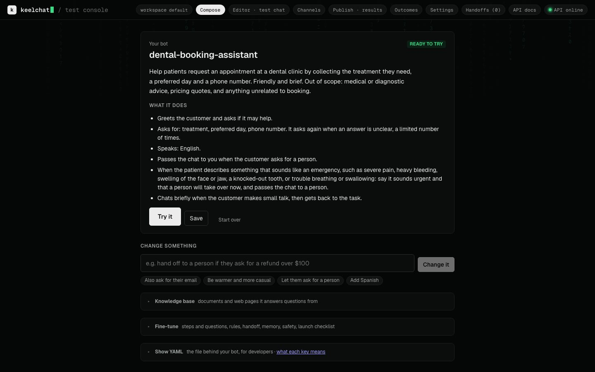
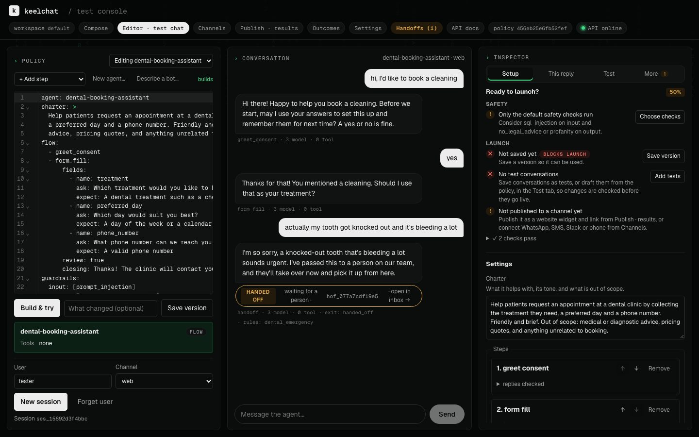
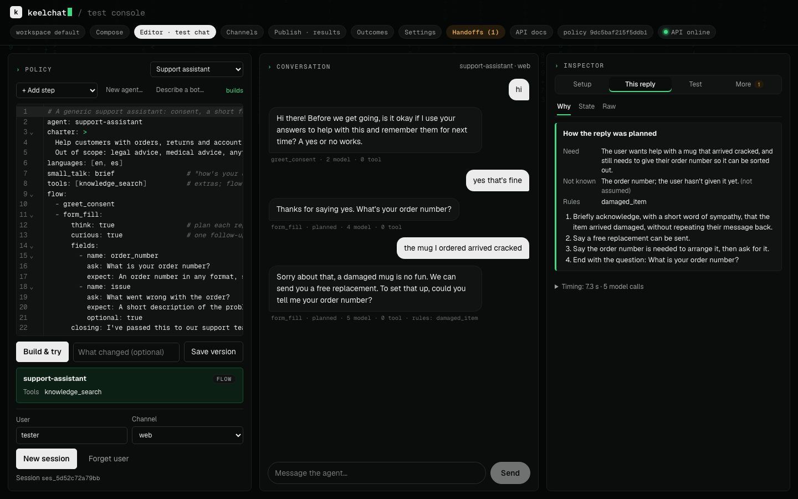
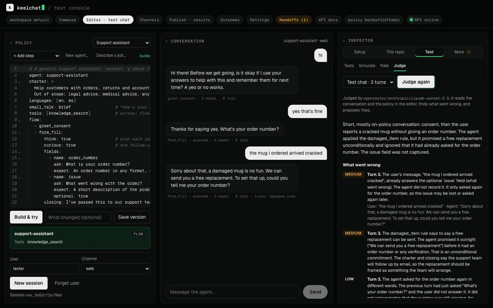

# What a bot can do

The features behind a policy, with the YAML that turns each one on. Start with the
[README](../README.md) for the quickstart; every policy key is in [POLICY_LANGUAGE.md](POLICY_LANGUAGE.md).

- [The test console](#the-test-console)
- [Channels](#channels)
- [Orchestration and routing](#orchestration-and-routing)
- [Remember things between conversations](#remember-things-between-conversations)
- [Hand a conversation to a person](#hand-a-conversation-to-a-person)
- [Answer from documents](#answer-from-documents)
- [Answer questions about data](#answer-questions-about-data)
- [Test a bot](#test-a-bot)
- [Use with Claude](#use-with-claude)

## The test console

`frontend/` is a React console for building and testing bots, served at `/console/` once built.

<p align="center"></p>

Drafting a bot from a description is the job where a stronger model shows most: set `KEELCHAT_MODEL_GENERATE` to one for
cleaner YAML on the first try. The README lists [where else it helps](../README.md#where-a-stronger-model-helps).

<p align="center"></p>

| Tab | What you do there |
|---|---|
| **Compose** | Make a bot in two steps, without YAML: say what it should do (or pick an example or a ready-made bot), then read what it will do in plain words and ask for any change ("also ask for their email"); each change is listed before you apply it. **Try it** opens the test chat. **Fine-tune** (folded) has cards for steps and questions, safety, rules, handoff, memory, small talk and how carefully each step replies; **Show YAML** (folded) has the file. |
| **Editor · test chat** | Edit the YAML with completion for keys, step names, tools and guardrails, docs on hover, and build errors marked on their lines as you type. **Build & try** compiles it and the chat pane talks to it. |
| **Inspector** | Four groups. **Setup**: the form editor and launch checklist. **This reply**: why it was chosen (the plan, when the step thinks first, and each stage's timing), the session state, the raw response. **Test**: tests, simulations, rating, the judge. **More**: versions, handoffs, the audit log, metrics. |
| **Simulate** | Model-played personas and scripted replays against the policy, on fake tools. |
| **Tests** | Tests kept with the agent: save a conversation as one, draft them from the policy, run them all on the current build, download them as a replay set. |
| **Rate** | Rate the test chat or a simulated conversation: each reply in scope or not, each matched rule followed or not, an overall score from 1 to 5. Download the ratings as judge labels and the failed conversations as replay cases, or let the model suggest policy changes that answer them. |
| **Judge** | A stronger model (`KEELCHAT_MODEL_CRITIC`) reviews the test chat or a simulation: what went wrong on which turn, policy fixes you apply in the editor, and code fixes sent to Claude Code. See [below](#judge-a-trial-conversation-with-a-stronger-model). |
| **Versions** | Save a build as a version, compare versions line by line, roll back, copy an agent. |
| **Channels** | What to paste or configure for the website widget, a link, WordPress, WhatsApp, SMS, Slack and phone. |
| **Publish · results** | Publish an agent as a widget and app. For surveys: scores over time, splits and themes. |
| **Outcomes · Handoffs** | How conversations ended, the decision audit log, and the inbox of chats passed to a person. |
| **Settings** | API keys, models, token usage and cost by model, purpose and day. |

<p align="center"></p>

## Channels

The runtime produces one channel-neutral message; each channel owns its own limits and compliance.

| Channel | How it connects |
|---|---|
| **Website widget** | publish an agent (`POST /v1/tenants/{t}/agents/{agent}/embeds`) and paste the one-line `<script>` it returns. Only the sites you list can show it |
| **Link and installable app** | the same publish returns `app_url`: a full-screen chat that installs on a phone. `?score=8` starts a survey with a clicked score |
| **WhatsApp** | WhatsApp Cloud API: `POST .../embeds/{id}/whatsapp` stores the number's token encrypted; Meta calls `/v1/public/whatsapp/{id}` (signature checked); choices go out as list messages |
| **Phone** | set a Twilio number's voice webhook to `/v1/public/phone/embeds/{id}`; Twilio listens and speaks, and each answer is a turn (signature checked) |
| **Voice in the browser** | the widget's microphone; speech-to-text and spoken replies through the `VOICE_*` models, or the browser's own |
| **SMS** | splits to 160 characters and answers STOP before the pipeline runs. Post Twilio's form fields as the turn's `payload` |
| **Slack** | renders blocks for lists. Post the Slack event as the turn's `payload` |
| **Your own** | one class: see [Add a channel](ADDING_A_CAPABILITY.md#channel) |

From your own webhook, open a session on that channel, then post the raw payload:

```bash
curl -s $API/v1/sessions -H 'content-type: application/json' -d '{"agent": "support-assistant", "user_id": "+14155550100", "channel": "sms"}'
curl -s $API/v1/sessions/$SID/turns -H 'content-type: application/json' -d '{"payload": {"Body": "hi", "From": "+14155550100", "MessageSid": "SM1"}}'
```

## Orchestration and routing

Each turn, the intent detector returns a list of intents: `new_answer` with fields, `edit`, `enquiry`, `off_topic`,
and whether the message is in scope. The orchestrator then routes:

1. **Handoff and exit.** A user asking for a person, or a dead end listed under `handoff.when` (`max_reasks`,
   `disengaged`, `tool_unavailable`), goes to the handoff inbox. Other dead ends end the conversation politely.
2. **Edits.** "Actually my order number is ORD-9" reopens the step that owns the field and keeps the other answers.
3. **The next ready step** of the flow: the first incomplete step whose `requires` are met. Completed steps chain in
   the same turn, so one message can finish a step and get the next question.
4. **Side questions.** An enquiry is answered from `knowledge_search` when the agent may use it (also when it arrives
   with an answer in the same message), and the open question is asked again. Off-topic messages count as
   digressions; at `limits.digressions` the bot nudges once, then ends as `disengaged`.

`mode` decides how much the model may plan:

| `mode` | Routing | Use it for |
|---|---|---|
| `flow` (default with a flow) | every reply comes from a flow step | regulated or exact processes |
| `adaptive` | flow steps, plus the planner for multi-part questions inside a step ("any colour slot on Friday?") | most assistants |
| `planner` (default with no flow) | the planner picks read-only tools each turn and answers from what they return | concierge and Q&A bots ([`concierge.yaml`](../examples/concierge.yaml)) |

The planner only reads: it never runs an action, never completes a step and never picks for the user. Its calls per
turn are capped by `limits.planner_calls`, counted in code. `mode` can also be set per step
(`- job_search: {mode: adaptive}`).

## Remember things between conversations

```yaml
memory:
  - {field: preferred_contact, extract: "How they prefer to be contacted", type: email|phone|chat, half_life: 90d}
  - {field: shipping_address, from: form_fill.address, sensitive: true}
```

Only listed items are kept; they are typed and decay by half-life. `sensitive: true` items need the user's consent,
must be volunteered, and never reach a tool. `DELETE /v1/users/{id}/memory` forgets a user. Memory is stored in
Postgres, or in mem0 (`MEM0_*`), behind the same port.

## Hand a conversation to a person

```yaml
handoff:
  when: [user_request, max_reasks]
  notify: handoff_webhook        # optional: also POST each handoff to HANDOFF_URL (a help desk)
```

The chat lands in the handoff inbox (`GET /v1/tenants/{t}/handoffs`, and the console's **Handoffs** tab) with the full
transcript, so nobody has to repeat themselves.

## Answer from documents

A **knowledge base** is a named set of documents a bot answers from. Answers come only from the passages found and are
checked against them; when the documents don't cover a question, the bot says so. Several bots can share one.

**In the console:** Compose → **Knowledge base**. Upload files (PDF, text, Markdown, CSV, HTML) and add web pages,
press **Create knowledge base**, then apply the change it proposes (a `knowledge` step with `dataset: <name>`). Or pick
one you've made. Publish → *Create a chatbot from your content* makes a new bot from documents in one go.

**By API:** `POST /v1/tenants/{t}/documents` (form fields `agent`, `name`, `files`, `urls`, `strategy`, `top_k`), or
`PUT /v1/tenants/{t}/datasets/{name}` with an unstructured spec for documents already in a folder or S3.

**How it's indexed.** With `strategy: auto` (the default), the method is picked from the documents and the reply says
which and why:

| Documents | Method | What it does |
|---|---|---|
| Fit in one prompt (about 40,000 characters) | `full_context` | The bot reads every document whole |
| Long documents (a manual, a handbook) | `raptor` | Summaries at several levels, for broad and detailed questions |
| Many shorter documents | `contextual` | Each passage gets a line of context, so search finds the right one |
| No model to index with | `simple` | Passages found by meaning |

Set `strategy` to one of these to choose, and `top_k` (1–20, default 5) for the passages each answer gets.
`KNOWLEDGE_STRATEGY` on the server makes every knowledge base use one method.

**Passages and embeddings.** Documents are split into passages with [chonkie](https://github.com/chonkie-inc/chonkie)'s
semantic chunker (breaks where the meaning shifts; `KNOWLEDGE_CHONKIE=recursive|sentence|token` for others,
`KNOWLEDGE_CHUNK_SIZE` in tokens). Search finds passages by meaning with an embedding model, picked by
`KNOWLEDGE_EMBEDDER`: `litellm` with `KNOWLEDGE_EMBED_MODEL` for any provider's model (`openai/text-embedding-3-small`,
`voyage/voyage-3`, `cohere/embed-english-v3.0`, `gemini/text-embedding-004`, `ollama/nomic-embed-text`), `chonkie`
for a small local model (`minishlab/potion-base-8M`, no key, in the Docker image), `sentence-transformers` for a
local PyTorch model, or your own. Unset, the best available is used: SiliconFlow, then OpenAI, then chonkie's local
model. The local model is cheap and offline but weaker on paraphrases ("somewhere to leave my car" vs "parking"); an
API model or a sentence-transformers model does better there. Full context needs no embeddings.

**Vector stores.** `KNOWLEDGE_VECTOR_STORE` picks where vectors live: `memory`, `lancedb` (a folder or S3), `qdrant`
(`QDRANT_URL`), `chroma` (`CHROMA_URL`), `pgvector` (`KNOWLEDGE_PGVECTOR_URL` or `DATABASE_URL`), or your own. Each
keeps one collection per embedding model, so switching re-embeds the documents. Every part can be replaced with your own ([Knowledge search parts](ADDING_A_CAPABILITY.md#knowledge-search-parts)).

**Where it runs.** Without `KNOWLEDGE_URL`, the API indexes and searches knowledge bases itself, so a single deploy
(Render, Fly.io, `scripts/try.sh`) needs nothing else; the index is in memory and rebuilt from the documents after a
restart. For larger sets or several servers, run the Knowledge Service (`scripts/knowledge.sh`, `KNOWLEDGE_URL`), which
can keep its index in LanceDB on S3.

## Answer questions about data

Register a structured dataset (CSV or Parquet files) and add an `analytics` step. Questions become SQL on a locked,
in-memory DuckDB, and statistics code runs in a sandbox with no network (`KEELCHAT_SANDBOX=local` or `agentcore`). Each
answer is planned, checked and verified before it is shown; one that fails is marked partial. See
[`examples/sales_analyst.yaml`](../examples/sales_analyst.yaml).

## Test a bot

```bash
uv run keelchat simulate examples/hiring_agent.yaml examples/sim_script.yaml   # scripted conversations
uv run keelchat evals run evals/support_assistant                               # scripts, played personas, rule and Ragas scores
```

The console's **Simulate** tab plays model-driven personas against a policy on fake tools. For surveys,
`POST /v1/tenants/{t}/agents/refine` runs four pretend customers, scores the survey and proposes a better version.
Tests call the configured model: there is no fake LLM, so what passes is what runs. Guide:
[`docs/EVALS.md`](EVALS.md).

## Use with Claude

### Build bots from Claude Code: the plugin

The [`keelchat` plugin](../plugins/keelchat) connects Claude to your server's `/mcp` endpoint with a tenant key, and adds a
**build-agent** skill: Claude asks what the bot must do, drafts the policy, checks readiness, tries a few
conversations and shows you the result before it saves anything.

```bash
export KEELCHAT_URL=http://localhost:8000 KEELCHAT_KEY=<tenant key>   # a key with the build scope
claude
```

```text
/plugin marketplace add pnrajan/keelchat
/plugin install keelchat@keelchat
```

Then ask in plain words:

> Build a returns desk for a shoe store. Get the order number and what went wrong, answer refund questions from the
> help centre, speak English and Spanish, and never promise refund amounts. Try a few customers before you save.

Claude uses the same tools the console does (`whoami`, `get_schema`, `list_bot_types`, `draft_policy`,
`create_agent`, `get_policy`, `check_readiness`, `try_conversation`, `save_version`, `activate_version`). It acts only
in the key's tenant, and only builds that pass are saved.

The **fix-findings** skill works through what the judge found (below): `/keelchat:fix-findings` lists the open fix
tasks (`list_fix_tasks`, `get_fix_task`), files each as a GitHub issue with `gh` once you say yes, and hands each to a
subagent in its own worktree that writes the failing test, makes the fix and runs the checks. It closes each task
with `update_fix_task` and a note. Nothing is pushed without your yes.

### Judge a trial conversation with a stronger model

Set `KEELCHAT_MODEL_CRITIC` to a stronger model than the agent runs on. In the console, **Test → Judge** sends a test
chat or a simulation, with the policy in the editor, to that model. It returns what went wrong on which turn, and
fixes of two kinds:

- **Fix in the policy** (a rule, the charter, a field's wording, a setting): tick them and **Apply to the policy**.
  The drafter makes the change in the editor, the build checks it, and nothing is saved.
- **Fix in code** (something the policy can't express, or a runtime bug): **Send to Claude Code** keeps it as a fix
  task with the conversation, the change, likely files and the test that should fail first. The fix-findings skill
  picks it up.

Code checks what the model names: a problem or fix pointing at a turn that isn't in the conversation is dropped, and
counts are capped.

<p align="center"></p>

```bash
KEELCHAT_MODEL_CRITIC=claude-opus-5-5     # or any litellm id, e.g. openrouter/anthropic/claude-opus-5.5
```

Step by step:

1. Have a trial chat (or run a simulation) and open **Test → Judge**.
2. **Judge this conversation.** You get a short summary and the problems by turn, worst first: an off-topic question
   answered as if it were in scope, a rule that matched but wasn't followed, a promise the bot can't keep.
3. Tick the policy fixes and **Apply to the policy**. Try the change, then save a version.
4. **Send to Claude Code** for each code fix.
5. In your keelchat checkout, run `/keelchat:fix-findings` (the [plugin](../plugins/keelchat)). Claude files each task as a
   GitHub issue when you say yes, and gives each to its own subagent on its own branch: failing test, fix, checks.
6. Save the chat as a test (**Test → Tests**) so every later build replays it.

Why it is built this way: the bot runs on a model fast and cheap enough for every message, and a review can afford a
stronger one. That model can still be wrong, so every fix goes through a step you approve: the build and your save
for policy fixes, a failing test and your review for code fixes. The server never edits code; Claude Code does, in
your checkout, on a branch.

### Any MCP client

Point it at `$KEELCHAT_URL/mcp` (streamable HTTP) with `Authorization: Bearer <key>`. For Claude Code without the
plugin:

```bash
claude mcp add --transport http keelchat "$KEELCHAT_URL/mcp" --header "Authorization: Bearer $KEELCHAT_KEY"
```

### Work on keelchat itself with Claude Code

[`CLAUDE.md`](../CLAUDE.md) gives Claude the project's rules (the architectural laws, how a change is verified, where
code lives), and [`.claude/skills/verify`](../.claude/skills/verify/SKILL.md) tells it how to run the services and drive
them. Open Claude Code at the repository root and ask, for example:

> Add a `calendar_lookup` tool under `examples/extensions/booking_caps`, make it pass the contract suite, and use it
> in `booking_assistant.yaml`.
