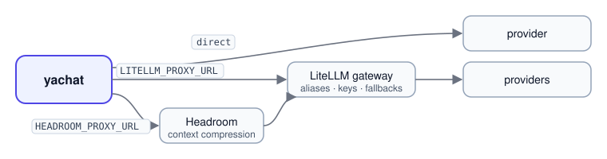

# Reference

Commands, routes, keys, model routing, dashboards, settings, deployment and troubleshooting. Start with the
[README](../README.md) for the quickstart.

- [CLI](#cli) · [HTTP API](#http-api) · [Tenants and API keys](#tenants-and-api-keys)
- [Model routing](#model-routing) · [Dashboards and long-term metrics](#dashboards-and-long-term-metrics) · [Configuration](#configuration)
- [Deployment](#deployment) · [Troubleshooting](#troubleshooting)


## CLI

```bash
uv run yachat new agent|package <name>                # starter files that build and pass the contract suite
uv run yachat build <policy.yaml>                     # validate and compile
uv run yachat schema                                  # JSON Schema of the policy, from the registry
uv run yachat registry                                # tools, steps, guardrails, pre-processors
uv run yachat serve --port 8000                       # the runtime API
uv run yachat simulate <policy.yaml> <script.yaml>    # scripted conversations
uv run yachat evals run [evals/<agent>]               # evaluation harness
uv run yachat knowledge serve|add ...                 # Knowledge Service and indexing
uv run yachat analytics serve                         # Analytics Service
```

## HTTP API

Interactive docs at `/docs`. The main routes:

| Route | Does |
|---|---|
| `POST /v1/agents`, `POST /v1/agents/validate`, `POST /v1/agents/draft` | compile a policy to try it, report its errors, draft one from a description |
| `POST /v1/tenants/{t}/agents`, `GET .../agents/{agent}/versions`, `POST .../versions/{n}/activate` | save versions, list them, roll back |
| `POST /v1/sessions`, `POST /v1/sessions/{id}/turns`, `GET /v1/sessions/{id}/state` | talk to an agent |
| `POST /v1/tenants/{t}/agents/{agent}/simulate` | simulated users on fake tools |
| `POST`, `GET /v1/tenants/{t}/agents/{agent}/reviews`, `GET .../reviews/labels.yaml`, `.../reviews/replay.yaml`, `POST .../reviews/suggest` | people's ratings of conversations; as judge labels and replay cases; policy changes that answer them |
| `POST`, `GET /v1/tenants/{t}/agents/{agent}/tests`, `DELETE .../tests/{id}`, `POST .../tests/run`, `POST .../tests/draft`, `GET .../tests.yaml` | tests kept with the agent: save, run on the current build, draft from the policy, export |
| `POST /v1/tenants/{t}/tools`, `PUT /v1/tenants/{t}/datasets/{name}` | register HTTP tools and datasets |
| `POST /v1/tenants/{t}/agents/{agent}/embeds` | publish as a widget, link and app |
| `GET /v1/tenants/{t}/handoffs`, `.../audit`, `.../dashboard`, `.../usage` | inbox, decision log, outcomes, cost |
| `GET /v1/tenants/{t}/agents/{agent}/findings`, `.../findings/aggregates`, `.../responses.csv` | survey results |
| `POST`/`GET /v1/tenants/{t}/keys`, `PUT /v1/tenants/{t}/plan` | API keys; per-tenant monthly limits |
| `GET /v1/registry`, `GET /v1/schema`, `GET /v1/metrics`, `/mcp` | capabilities, policy schema, latency, the MCP server |

## Tenants and API keys

`YACHAT_API_KEY` is the admin key. Issue keys per tenant with `POST /v1/tenants/{t}/keys`; each is shown once and
stored as a hash. A key reaches only its own tenant.

| Scope | Allows |
|---|---|
| `build` | everything in its tenant |
| `read` | read-only access |
| `runtime` | sessions and turns only: the key for a website or messaging backend |

With `YACHAT_JWT_SECRET`, keys are signed JWTs whose tenant, scopes and expiry are set by the server.

## Model routing

<p align="center"></p>

| Layout | Set |
|---|---|
| Direct | `YACHAT_LLM=anthropic` or `litellm` plus the provider key; model ids like `openai/gpt-4o-mini` or `siliconflow/<model>` |
| LiteLLM gateway | `LITELLM_PROXY_URL`, `LITELLM_PROXY_KEY`; model ids are the gateway's aliases |
| Headroom → LiteLLM | add `HEADROOM_PROXY_URL`; context is compressed before the gateway |

`YACHAT_MODEL_CLASSIFY` (intents, validation, planning) and `YACHAT_MODEL_GENERATE` (replies) are the two tiers, and
`YACHAT_MODEL_VERIFY` checks reasoning and replies.

**Cost tracking** works with every layout. Each model call is recorded with its tokens in and out, cached tokens,
time and cost, and summed by model, purpose, agent and day on the console's **Settings** page
(`GET /v1/tenants/{t}/usage`). The Analytics Service's own calls are added to the turn that asked.
- Behind a LiteLLM gateway, aliases like `large` are priced as the model the gateway actually routed to, or at the
  cost the gateway reports.
- Behind Headroom, the tokens it removed are shown as **saved**. Headroom compresses tool-result messages, not chat
  text, so savings depend on the traffic.
- Prices come from `YACHAT_MODEL_PRICES`, then the gateway, then OpenRouter's public list, then litellm's.
- A model client you write yourself gets all of this by decorating its provider call with `@metered`
  ([`runtime/usage.py`](../yachat/runtime/usage.py)).

## Dashboards and long-term metrics

Every model call, turn, answer, exit and handoff is an audit record. The dashboards (cost, outcomes, the audit
summary and key metrics) add those records up in **DuckDB** over the whole window you ask for; there is no row cap.

| Where records are | How the dashboards read them | Set |
|---|---|---|
| In memory | inserted into DuckDB | nothing (development, tests) |
| Postgres (recent) | `COPY` of one tenant's window into DuckDB | `DATABASE_URL` |
| S3 archive (older) | DuckDB reads the Iceberg table's Parquet files on S3 directly, only that tenant's days | `AUDIT_ARCHIVE_WAREHOUSE=s3://bucket/prefix` |

With the archive on, records are copied to S3 daily. Postgres keeps the last 7 days, the archive keeps everything
up to `AUDIT_RETENTION_DAYS`, and each dashboard reads older days from S3 and recent ones from Postgres, counting
each record once. S3 credentials come from the usual AWS variables (`AWS_ENDPOINT_URL_S3` for MinIO). Athena,
Spark, Trino or your own DuckDB can read the same table. How it works: [ARCHITECTURE.md](ARCHITECTURE.md).

## Configuration

Everything is an environment variable, loaded from `.env`; [`.env.example`](../.env.example) documents every key. Only
the model provider is required; everything else runs in memory when unset.

<details>
<summary><b>All variables</b></summary>

| Variable | Purpose |
|---|---|
| `YACHAT_LLM`, `*_API_KEY`, `YACHAT_MODEL_*` | provider, key and model tiers; a missing key raises, nothing falls back to a fake |
| `YACHAT_API_KEY`, `YACHAT_JWT_SECRET` | the admin key; signed tenant keys |
| `REDIS_URL`, `DATABASE_URL` | Redis for sessions; Postgres for memory, versions, datasets, tools, audit, handoffs and rate limits. In-process when unset (`scripts/db.sh up` starts both) |
| `YACHAT_CAPABILITY_PACKAGES`, `YACHAT_MCP_SERVERS` | extension packages and MCP servers to load capabilities from |
| `KNOWLEDGE_URL`, `ANALYTICS_URL`, `YACHAT_DATA_ROOT`, `YACHAT_DATA_BUCKETS` | the Knowledge and Analytics Services, and where dataset sources may live |
| `YACHAT_SANDBOX` | `local` or `agentcore`: where statistics code runs; unset for SQL-only answers |
| `YACHAT_UPLOADS_BUCKET` | S3 bucket for uploaded content and files; unset, a folder under `YACHAT_DATA_ROOT` |
| `YACHAT_EMBED_SECRET`, `YACHAT_PUBLIC_URL` | signs widget conversation tokens; the public address links point at |
| `VOICE_STT_MODEL`, `VOICE_TTS_MODEL`, `TWILIO_AUTH_TOKEN` | voice in the widget; phone calls through Twilio |
| `HANDOFF_URL`, `HANDOFF_TOKEN` | where `handoff_webhook` sends each handoff |
| `MEM0_API_KEY` or `MEM0_QDRANT_URL` | user memory in mem0 instead of Postgres |
| `AUDIT_RETENTION_DAYS`, `AUDIT_ARCHIVE_WAREHOUSE` | audit retention; an archive in an Apache Iceberg table on S3 |
| `YACHAT_DUCKDB_EXTENSIONS` | where DuckDB's iceberg, httpfs and aws extensions are installed (the Docker image sets it), so dashboards read the archive without a download |
| `SENTRY_DSN` | errors and traces per stage and model call; no message text is sent |
| `YACHAT_TOOLS=fake` | development only: fake backends for tools whose URL is unset |

</details>

## Deployment

```bash
docker build -t yachat . && docker run -p 8080:8080 --env-file .env yachat
```

One image serves the API (with the console), the Knowledge Service or the Analytics Service; the process command
picks which (`deploy/entrypoint.sh`). It runs as a non-root user and exposes `/health`. `docker-compose.yml` runs
Redis, Postgres and an optional LiteLLM gateway next to it.

Where the code lives: the structure map in [`CLAUDE.md`](../CLAUDE.md#4-structure), or by task in
[`DEVELOPER_GUIDE.md`](DEVELOPER_GUIDE.md#where-things-live).

## Troubleshooting

| Symptom | Fix |
|---|---|
| A reply says it can't do something "right now" ("I can't look that up right now…") | the tool's service is down or its URL is unset: start it (`./run.sh` starts Knowledge and Analytics), or run with `--fake-tools` |
| "The API no longer has this policy" or "This session is no longer on the server" | the API restarted with in-memory state: **Build & try** again and start a new session, or set `DATABASE_URL` and `REDIS_URL` |
| API exits at start with a database error | `DATABASE_URL` names a missing database: `scripts/db.sh up`, or leave it empty |
| **Save version** is disabled | the editor found problems; only valid builds are saved. Fix the marked lines |
| Console shows "API offline" | the API process is down: check the terminal running `./run.sh` |

Every log line carries `session_id`, so `grep <session_id>` follows one conversation. More in
[`DEVELOPER_GUIDE.md`](DEVELOPER_GUIDE.md#debugging).
